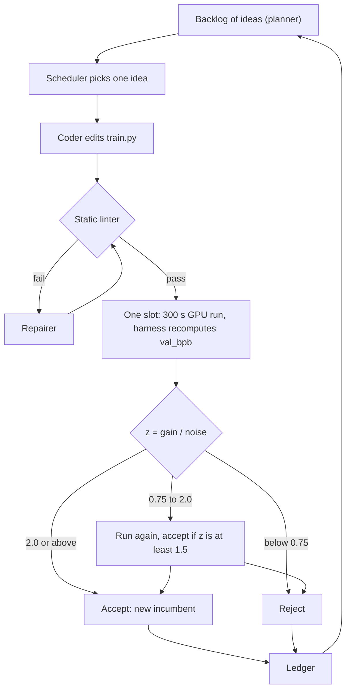

# avrl-autoresearch

**Which steps of an automated research loop need a strong model, and which can use a cheap one?**

An automated research loop is a set of language models that tries to improve a program on its own: one model proposes ideas, another writes the code, a run scores the result, and the loop keeps the change only if the score really improved. This repository builds such a loop, measures how noisy it is, and tests which steps can be handed to cheaper models.

The work came in two rounds:

- **Round 1 (October to early November 2026).** The loop, its noise, and role routing on one task, a small GPT training script (studies R1, P1, P2, P3).
- **Round 2 (November 10 to 20, 2026).** A replication, a check of whether that task can rank loop designs at all, six other tasks, and a new task with exact scoring (equation discovery) where the question could be asked cleanly.

Most results of round 2 are negative. They are reported with the verdict that the rules written before each run give them.

## The short answers

1. **Role routing replicates on the GPT training task, but the task is too simple to lean on.** A strong planner with a cheap coder kept almost all of the gain at a fraction of the model cost, twice (P2, P2B). But a random search with no model over eight named settings recovers 0.90 of the same gain. Two settings of the final script explain 94 percent of it.
2. **Loops report gains that are not there.** A keep-if-lower loop kept about 7 edits per run and 5 failed a rerun. Replaying a loop on runs of the unchanged script gives a "gain" of 0.013 bits per byte in 98 percent of loops. On the CIFAR task loops reported 4 to 5 times the held-out gain.
3. **On five harder tasks the cheap model was as good as the strong one.** On the CIFAR-10 speedrun, four drug-property tasks and circle packing, Haiku matched or beat Sonnet at about a quarter of the cost, so there was nothing to route between them. A role effect appeared only one tier down, between Haiku and an open 12B model.
4. **Loops stop finding things early.** Continuing 28 loops from slot 40 to slot 80 gave 8 accepted edits in 1,120 slots.
5. **A single call can match a loop.** On a 26-circle packing task all 9 loops reached the best known packing, but one Haiku call with no loop reaches it 5 times in 20.
6. **Equation discovery is the first task here where the strong model does what the cheap one cannot in one attempt.** Even so, chains of cheap attempts close most of the gap at real prices, so a cost-per-success rule for choosing the next model only ties simple fixed plans.
7. **Why the cheap model fails on the hard equations.** Unknown terms of a law hide each other, and a tool that tells the model which term is wrong does not fix it, because the cheap model does not propose the missing form.
8. **Model cost is not the whole bill.** Routing cut model spend 6 to 8 times on the GPT task, but GPU time dominates there, so the total saving is 17 to 38 percent.

**Read this first:** the role findings of round 1 come from a study (P2) whose own verdict is KILL, because its validity check failed. The replication (P2B) is PARTIAL, and its no-model control shows the task cannot rank loop designs. Treat the role findings as leads.

## How the loop works

The first task is Karpathy's autoresearch setup for nanochat (pinned at commit `228791f`). The loop may edit one file, `train.py`. Each run trains a small language model for 300 seconds on one A100 GPU and is scored by `val_bpb`: bits per byte on validation data, lower is better.



Four ideas carry the design:

- **Roles.** The planner writes the backlog of ideas. The coder turns one idea into an edit. The repairer fixes edits that fail the linter. A critic reviews decisions the loop escalates.
- **Noise.** Rerunning the unmodified script moves the score by about 0.004 bits per byte (standard deviation over 16 runs; 0.007 over a later pool of 96 runs). Many candidate gains are that small.
- **The z rule.** A gain is divided by the noise, giving z ("gain in units of noise"). Below 0.75 the edit is rejected, at 2.0 or above it is accepted, and in between it is run again and accepted only if z over all its runs is at least 1.5.
- **The loop cannot grade itself.** The harness recomputes the score from raw model outputs, and each loop's final program is rerun on fresh seeds against a sealed validation set the models never see. The gain on that sealed set is the **held-out gain**.

One run is a **slot**. A **routing table** says which model fills which role. The same engine runs the other loop tasks below with a different harness.

## Words used in the tables

- **Cell names.** Two letters give planner and coder: S Sonnet, H Haiku, G Gemma 12B (open), Q Qwen 4B (open), T the cheap coder table of round 1. N is a search with no model.
- **Gap recovered.** (gain of a design minus gain of the all-cheap loop) divided by (gain of the all-strong loop minus gain of the all-cheap loop). 0 is the cheap loop, 1 is the strong loop.
- **Advantage.** Gap recovered minus the same ratio computed on model dollars. 0 is the straight line between the two anchors, 1 is the strong gain at the cheap price.
- **Progress.** On the drug-property and packing tasks: 0 is the starting script, 1 is the best published result.
- **Nominal USD.** Model cost at list prices. Open models ran on local GPUs and are priced at hosted list prices.

## Tasks

| Task | Code | Score | Used in |
|---|---|---|---|
| GPT training script (nanochat) | `loop/substrate/` | validation bits per byte, noisy | R1, P1, P2, P2B |
| Data curation for a small trainer | `curation/` | sealed bits per byte, noisy | C1, curation R1, S6, G1, G1B |
| CIFAR-10 speedrun script | `loop/cifar/` | training time and accuracy in one cost, noisy | CG1 |
| Four drug-property tasks (TDC ADMET) | `loop/bench/` | progress toward the leaderboard best | BG1, H1, E1, B1, B2 |
| Circle packing, 26 and 32 circles | `loop/bench/`, `loop/shinka/` | sum of radii | BG1, H1, E1, S1 |
| Equation discovery from generated data | `loop/sr/` | exact: a law is right or wrong | SR0 to SR6 |

## Round 1 experiments

Pass and kill rules were written down before the runs.

| Study | Question | Result | Verdict |
|---|---|---|---|
| **R1** (22 loops) | Does a loop with cheap models per role lose gain against an all-Sonnet loop? | All four designs gained about 0.06 bits per byte. Routed minus control: -0.0038 (90 percent interval -0.0084 to +0.0009, p = 0.18) | INCONCLUSIVE: too few loops to settle a gap this small |
| **P1** (R1 data, split in half) | Do the designs settle at different speeds, can a stop rule save money, and does noise explain the failed audits? | The control settles 12.5 slots sooner. Stopping after 5 quiet slots keeps 80 percent of loops within 0.004 at 51 percent of the cost. 23 failed audits against 15 to 25 predicted by noise | PASS, three of three |
| **P2** (60 loops) | Which role needs the strong model? Planner (Sonnet or Qwen 4B) crossed with coder (Sonnet or cheap), plus a deliberately damaged loop as a validity check | Weak planner -0.036 (interval -0.044 to -0.028, p below 0.001). Cheap coder -0.006 (p = 0.40) at 0.13 times the model cost | KILL: the damaged loop was not detected (p = 0.22, needed below 0.05) |
| **P3** (1,196 calls) | Does more reasoning effort make a cheap critic more accurate? | Accuracy 0.82 at low effort and 0.81 at high, at 1.9 times the cost | No robust verdict |

### P2 in more detail

| Cell | Planner | Coder | Held-out gain | Model USD per loop |
|---|---|---|---|---|
| SS | Sonnet | Sonnet | 0.0545 | 1.43 |
| ST | Sonnet | cheap | 0.0560 | 0.25 |
| QS | Qwen 4B | Sonnet | 0.0257 | 1.66 |
| QT | Qwen 4B | cheap | 0.0124 | 0.15 |
| H (damaged) | Sonnet | Sonnet, half of edits replaced by a do-nothing edit | 0.0328 | 1.45 |

- **Why the planner matters.** One edit, cutting the batch size, explains 78 percent of the variation in gain. Sonnet planners put it in their first idea list in 36 of 36 loops. For Qwen planners the count depends on how strictly the idea is matched: 5 of 24 by a strict rule and 12 of 24 by a loose one (the first version of this README said 10). The planner decides which levers get pulled.
- **Why the verdict is KILL.** The damaged loop (H) had to be detected as slower at reaching the small batch size. It was not, because even the healthy all-Sonnet loops reached it in only 5 of 12 cases, so the test had too few events. The rules rank this failure above every other outcome. (On held-out gain, H did lose 0.022 against SS, p = 0.005, but that was not the registered test.)
- **A lesson about tryouts.** Before the study, a planner tryout scored every candidate model 12 of 12. It only checked the format of the reply, not whether the ideas were good.
- **Deviation.** A provider outage (HTTP 403 for about two hours) hit 28 loops. They were rerun from scratch; the planner effect is -0.0365 on the untouched loops and -0.0355 on the reruns.

### Cost

| | Model USD per loop | With GPU time (2 USD per A100-hour) |
|---|---|---|
| R1 all-Sonnet control | 0.78 | 5.42 |
| R1 full design, no routing | 1.44 | 6.05 |
| R1 full design, routed | 0.24 | 4.49 |

Routing saves 6 times in model dollars but 17 to 26 percent of the total (about 38 percent for the cheap coder in P2).

## Round 2 experiments

Each study has a rules file in `loop/design/` or `curation/design/` written before its run, and a write-up. Deviations are listed in the rules files.

### GPT training task: replication and controls

| Study | Question | Result | Verdict | Write-up |
|---|---|---|---|---|
| **P2B** | Does P2 replicate with new loops? | Sonnet planner with cheap coder: advantage 0.87 (0.67 to 1.15), 0.91 pooled with P2. The claim that the cheap coder loses nothing missed its margin: -0.0019 (interval -0.0109 to +0.0081) against -0.010. Two settings of the final script explain 94 percent of the variance in gain over 83 loops | PARTIAL | `loop/RESULT_P2B.md` |
| **Cell N** | How far does a random search with no model get? | Random search over eight named settings: held-out gain 0.0485, gap recovered 0.90 (0.71 to 1.14), not separable from the all-Sonnet loop (p = 0.23). The eight settings were chosen by a person who knew the script | The task is too simple to rank loop designs | `loop/RESULT_P2B.md` |
| **No-effect pools** | How much gain does a loop report when nothing changed? | 96 runs of the unchanged GPT script (sd 0.007) and 160 of the CIFAR script (sd 0.027). Plain keep-if-better reports 0.013 bits per byte in 98 percent of GPT loops. The z rule reports 0.001 to 0.002 in 8 to 12 percent of GPT loops, and 0.026 in 46 percent of CIFAR loops | Descriptive | `loop/null/RESULT_NULL.md` |
| **W1** | Do the internal activations of a small open model that reads a proposal predict its outcome? | On 3,283 logged proposals: yes inside a task (AUROC 0.92 for crashes, 0.94 for promising runs; free signals reach 0.85 and 0.87), no across tasks (0.50). Nothing gained for routing over the free signals | Negative for routing | `loop/w1/RESULT_W1.md` |

### Data curation task

The loop picks training documents for a small trainer. The task turned out shallow: most of the gain comes from one good plan.

| Study | Question | Result | Verdict | Write-up |
|---|---|---|---|---|
| **C1** (48 loops) | Which role needs the strong model? | Fable planner with Gemma 12B coder reached the all-Fable gain in 4 of 4 loops at a quarter of the cost (0.1244 at 2.52 USD against 0.1233 at 10.28 USD). The damaged-loop check failed, as predicted for a shallow task | SHALLOW | `curation/RESULT_C1.md` |
| **Curation R1** (20 loops) | Do routing tables fitted on C1 ledgers hold on a new document pool? | Two fitted tables reached advantage 0.76 (0.31 to 1.86) and 0.96 (0.64 to 2.04). The first was not separable from the fixed "strong planner, cheap coder" design | Two of three rules hold. Labelled a demonstration | `curation/RESULT_R1.md` |
| **S6** (12 loops) | Does memory of past strong runs replace the strong planner? | Reusing an old strong file with no model: 7 of 8 at the strong level at 0 USD. A small planner trained on old strong ideas: +0.037 bits per byte over the plain one, p = 0.11 | Both rules fail. The reuse result is descriptive | `curation/RESULT_S6.md` |
| **G1, G1B** | Does a strong judge model add anything when curating real web pages with skills (dedup, cleaning, embedding filters, judges)? | The full pipeline beats the fixed one by 0.040 bits per byte (3.9 noise sds). A strong judge adds nothing over a free embedding ranking. Cleaning is worth 0.25, ranking 0.04, combining rankings 0.02 | Closed: nothing to route inside the skills | `curation/RESULT_G1.md`, `curation/RESULT_G1B.md` |

### Looking for a task that can rank loop designs

| Study | Question | Result | Verdict | Write-up |
|---|---|---|---|---|
| **CG1** (24 loops) | Is the CIFAR-10 speedrun such a task? | Held-out gain: random search 0.000, Sonnet 0.019, Haiku 0.034. The loops themselves reported 0.018, 0.091 and 0.108. One known trick is 61 percent of the gain | Gate FAILED | `loop/RESULT_CG1.md` |
| **BG1** (6 tasks) | Same gate on four drug-property tasks and two packing tasks | Progress on the drug tasks: no model 0.23, Sonnet 0.82, Haiku 0.80. On packing: 0.00, 0.56, 0.77 | The tasks are real and a menu does not solve them, but Haiku is as good as Sonnet | `loop/RESULT_BG1.md` |
| **K1** | Can the gap between two models be predicted from their idea lists, before any experiment? | The score ordered the six tasks (Spearman 0.89). Its yes or no threshold was wrong (3 of 6) | Mixed | `loop/RESULT_BG1.md`, `loop/design/K1_PREREG.md` |
| **H1** (42 loops) | Haiku against an open 12B model, by role | Packing: all Gemma 0.06, Haiku planner with Gemma coder 0.53, Gemma planner with Haiku coder 0.65, all Haiku 0.77. Drug tasks: 0.56, 0.62, 0.69, 0.80 | Packing claims hold. The drug gate missed by a hair. The two swaps do not differ significantly | `loop/RESULT_H1.md` |
| **E1** (28 loops) | Do loops find more between slot 40 and slot 80? | 8 accepted edits in 1,120 slots. Held-out progress +0.006, while the loops reported +0.035 | No | `loop/RESULT_E1.md` |
| **B1, B2** (23 stalled states, 832 calls) | At a stalled loop, do stronger planners find what the cheap one cannot? | Promising ideas out of about 229 each: Haiku 6, Sonnet 13, Opus 18, Fable 12, with no steady pattern over states. The coder model made no difference | Not supported | `loop/design/B2_PREREG.md` |
| **S1** (9 loops) | The loop on ShinkaEvolve's 26-circle task, from their start program | All 9 loops reach the best known packing (2.6359830849, a tie and not a record), Haiku in 14 to 19 evaluations for 0.15 to 0.25 USD. Control: one Haiku call with no loop reaches it 5 times in 20, one Sonnet call 6 times in 12 | The task is saturated: the model finds the packing, not the loop | `loop/RESULT_S1.md` |

### Equation discovery

A problem is a table of noise-free measurements made from a hidden law with 2 to 4 terms, generated fresh by `loop/sr/gen.py` so that nothing can be recalled from training data. One attempt is one model session with two tools (run Python on the data; score a candidate law) and at most 14 tool calls. A law counts as found when its error on unseen rows is at most 1e-10, so the same candidate always gets the same verdict. A chain is a sequence of attempts in which each one sees the best candidates of the earlier ones.

Successes per fresh attempt (60 problems, 1,020 sessions):

| Level, easiest first | Haiku, 0.0075 USD | Sonnet, 0.074 USD | Fable, 0.47 USD |
|---|---|---|---|
| 1 | 133 of 144 | 45 of 48 | 12 of 12 |
| 5 | 59 of 144 | 25 of 48 | 12 of 12 |
| 2 | 1 of 144 | 3 of 48 | 10 of 12 |
| 6 | 1 of 144 | 2 of 48 | 10 of 12 |
| 3 | 0 of 144 | 0 of 48 | 5 of 12 |

| Study | Question | Result | Verdict | Write-up |
|---|---|---|---|---|
| **SR1** | Does a cost-per-success index choose the next model better than fixed plans? | The rule beats every single model and two bandit baselines. It ties the best fixed cascade. How close Haiku got does not predict that a stronger model will solve the problem (AUC 0.49) | 2 claims pass, 2 fail, 1 half | `loop/RESULT_SR1.md` |
| **SR2** | Keep refining, start over, pay for a stronger model, or stop? | Haiku chains alone solve 48 of 60 problems for 9.05 USD. One Fable attempt per problem solves 49 for 28.48 USD. The index rule scores 0.792 against 0.780 for "one Haiku chain, then Fable" | 4 of 6 claims fail: at real prices there is no routing decision on this task | `loop/RESULT_SR2.md` |
| **SR3** | Can a chain that has run out of new ideas be detected? | Both claims fail | Dropped | `loop/RESULT_SR3.md` |
| **SR4** | How much is a hint about the law worth to Haiku, counted in bits? | Level 3 chains solved: no hint 1 of 24, the one unusual term told (4.1 bits) 15 of 24, the two ordinary terms told (10.3 bits) 11 of 24 | The hard-terms hint is ahead at level 4 (+0.375, interval +0.167 to +0.625) | `loop/RESULT_SR4.md` |
| **SR5** (584 sessions) | The full table of which terms are told | Level 3 share solved: nothing told 0.04, S 0.12, CS 0.21, U 0.62, S and CS 0.46, S and U 0.92, CS and U 1.00. With two terms unknown the share is far below what the one-term results predict | 2 claims pass, 1 fails | `loop/RESULT_SR5.md` |
| **SR6** (189 sessions) | Does a tool that reports which terms of a wrong law are right undo this? | Solved with the tool: 0 of 24 and 4 of 24. Without it: 1 of 24 and 3 of 24. The tool confirmed the product term in 23 of 48 chains and Haiku kept it, but Haiku proposed three of the unusual forms in only 3 of 60 chains | FAILED | `loop/RESULT_SR6.md` |

S is a term with a simple factor, CS a product of two factors, U a term with an unusual factor.

### What round 2 adds up to

A routing decision between a cheap and a strong model only exists when three things hold at once: a short menu of settings does not solve the task, the strong model does something the cheap one cannot, and the cheap model cannot get there with more tries at its own price. The GPT task fails the first. The CIFAR, drug-property and packing tasks fail the second. Equation discovery passes the first two, and then mostly fails the third: cheap chains close the gap on most problems. What is left on the hardest problems is a gap in what the cheap model proposes, and telling it more about its own errors did not close it.

## Limits

- **Small samples.** Most cells have 2 to 12 loops or chains. Intervals are wide and are given in the write-ups.
- **P2 is a KILL and P2B is PARTIAL.** Cell N shows the GPT task cannot rank loop designs.
- **Loop-reported gains are biased upward.** Only held-out numbers are comparable across designs.
- **Packing scores depend on machine load.** Scores of identical scripts moved by 0.1 to 0.2 progress between scorings (see `loop/RESULT_E1.md`), so small packing differences are not reliable.
- **Equation problems come from fixed lists of terms.** They are generated by a program, so someone who knows the lists could solve them by enumeration. The models are not told the lists.
- **SR6 compares against stored chains** from the two days before, not chains run alongside.
- **Post hoc analyses are marked as such** in each write-up. Several of the explanations above (for example why the tool did not help) are post hoc.
- **The equation-discovery stages are recent.** Their rules files and write-ups say in their headers how they were produced and have not had an independent audit.
- **One family of models for most cells.** The strong and cheap models are from one provider; the open models are a 4B and a 12B model.

## Repository layout

```
loop/              the research loop and the round 2 studies
  core/            loop engine, z rule, scheduler, ledger, analyses (P2, P2B, random search)
  models/          model call layer, prices, spend guard
  substrate/       GPU workers, scoring harness, pinned nanochat base
  p1/              the P1 re-accounting study
  cifar/           CIFAR-10 speedrun task (CG1)
  bench/           drug-property and packing tasks (BG1, H1, E1)
  shinka/          26-circle task from ShinkaEvolve's start program (S1)
  null/            no-effect pools and replay
  w1/              proposal outcomes from model internals (W1)
  k1/              idea-gap score (K1)
  ideas/           stalled-state idea bank (B1, B2)
  sim/             loop simulator, first version
  index/           exact check of the index rule on a small model of the loop
  sr/              equation discovery: generator, scoring, tools, chains, hint tables, term check
  design/          rules files written before each run
  runs/            stored run data
  RESULT_*.md      write-ups
curation/          the data curation task and its studies (C1, R1, S6, G1, G1B)
avrl/              a separate, earlier study in the same repository (see avrl/README.md); also holds the P3 code and results
archive/           files outside the core project
```

Raw job logs, per-session scratch copies and model weights are not stored (see `.gitignore`). The hinted problem folders under `loop/sr/problems_advice*` and `loop/sr/problems_iso` link to `loop/sr/problems_main` by absolute path; rebuild them with `advice.py make` and `advice2.py make` on another machine.

## Reproducing the analyses

No GPU or model call is needed for these; they read the stored run data.

```bash
python3.12 -m venv .venv && .venv/bin/pip install -r requirements-analysis.txt

# R1
.venv/bin/python -m loop.core.analysis --run loop/runs/R1 --out loop/runs/R1/analysis
.venv/bin/python -m loop.core.cost_report --run loop/runs/R1 --calibration loop/runs/calibration

# P1
.venv/bin/python loop/p1/reaccount.py --half burnin
P1_ALLOW_TEST=1 .venv/bin/python loop/p1/reaccount.py --half test --rule after_first:5

# P2
.venv/bin/python -m loop.core.analysis_p2 --run loop/runs/P2F --out loop/runs/P2F/analysis

# P2B with cell N
.venv/bin/python -m loop.core.analysis_p2b --run loop/runs/P2B --pool-csv loop/runs/P2F/analysis/loops.csv --n-run loop/runs/P2B_N

# Equation discovery, SR6 (own environment: numpy, scipy, pandas)
python3.12 -m venv loop/sr/.venv && loop/sr/.venv/bin/pip install numpy scipy pandas
cd loop/sr
.venv/bin/python iso_table.py --tool ../runs/SR6 --base ../runs/SR4 ../runs/SR5
.venv/bin/python iso_why.py --tool ../runs/SR6 --base ../runs/SR4 ../runs/SR5 --src problems_main
cd ../..

# Tests (one suite per process)
for d in loop/core/tests loop/models/tests loop/substrate/tests loop/p1/tests; do
  .venv/bin/python -m pytest "$d" -q
done
```

The other round 2 analyses are named at the top of each write-up.

## License

MIT. See `LICENSE`.

Contact: Rustom Dubash, rdubash@haverford.edu
