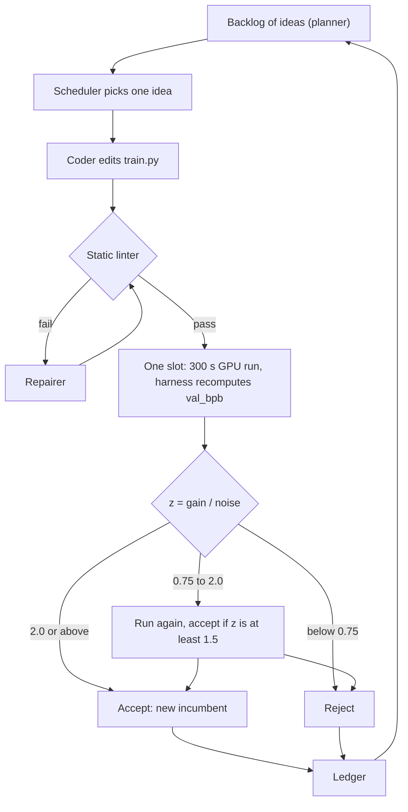

# avrl-autoresearch

**Which roles in an automated research loop need a strong model, and which can use a cheap one?**

An automated research loop is a set of language models that tries to improve a program on its own: one model proposes ideas, another writes the code, a GPU run scores the result, and the loop keeps the change only if the score really improved. This repository builds such a loop, measures how noisy it is, and tests which roles can be handed to cheaper models.

## The short answers

1. **The planner needs the strong model.** Swapping the planner (the role that chooses what to try) from the strong model (Sonnet) to a 4B open model (Qwen) lost 0.036 bits per byte of gain, about two thirds of the total (p below 0.001, same direction in 11 of 12 blocks).
2. **The coder did not show a need for it.** A cheap coder (the role that writes the edit) lost 0.006 bits per byte, not significant, at 0.13 times the model cost.
3. **Most "improvements" in a naive loop are noise.** A keep-if-lower loop kept about 7 edits per run, and 5 of them failed a rerun on a fresh seed.
4. **Model cost is not the whole bill.** Routing cut model spend 6 to 8 times, but GPU time dominates, so the total saving is 17 to 38 percent.

**Read this first:** answers 1 and 2 come from a study (P2) whose own preregistered verdict is KILL, because its validity check failed. They are strong leads to replicate, not confirmed results. Details below.

## How the loop works

The task is Karpathy's autoresearch setup for nanochat (pinned at commit `228791f`). The loop may edit one file, `train.py`. Each run trains a small language model for 300 seconds on one A100 GPU and is scored by `val_bpb`: bits per byte on validation data, lower is better.



Four ideas carry the design:

- **Roles.** The planner writes the backlog of ideas. The coder turns one idea into an edit. The repairer fixes edits that fail the linter. A critic reviews decisions the loop escalates.
- **Noise.** Rerunning the unmodified script moves the score by about 0.004 bits per byte (standard deviation over 16 runs). Many candidate gains are that small.
- **The z rule.** A gain is divided by the noise, giving z ("gain in units of noise"). Below 0.75 the edit is rejected, at 2.0 or above it is accepted, and in between it is run again and accepted only if z over all its runs is at least 1.5.
- **The loop cannot grade itself.** The harness recomputes the score from raw model outputs, and each loop's final program is rerun on fresh seeds against a sealed validation set the models never see. The gain on that sealed set is the **held-out gain** reported below.

One GPU run is a **slot**, and every loop gets 20. A **routing table** says which model fills which role.

## Experiments

All pass and kill rules were written down before the runs (preregistered).

| Study | Question | Result | Verdict |
|---|---|---|---|
| **R1** (22 loops) | Does a loop with cheap models per role lose gain against an all-Sonnet loop? | All four designs gained about 0.06 bits per byte. Routed minus control: -0.0038 (90 percent interval -0.0084 to +0.0009, p = 0.18) | INCONCLUSIVE: too few loops to settle a gap this small |
| **P1** (R1 data, split in half) | Do the designs settle at different speeds, can a stop rule save money, and does noise explain the failed audits? | The control settles 12.5 slots sooner. Stopping after 5 quiet slots keeps 80 percent of loops within 0.004 at 51 percent of the cost. 23 failed audits against 15 to 25 predicted by noise | PASS, three of three |
| **P2** (60 loops) | Which role needs the strong model? Planner (Sonnet or Qwen 4B) crossed with coder (Sonnet or cheap), plus a deliberately damaged loop as a validity check | Weak planner -0.036 (interval -0.044 to -0.028, p below 0.001). Cheap coder -0.006 (p = 0.40) at 0.13 times the model cost | KILL: the damaged loop was not detected (p = 0.22, needed below 0.05) |
| **P3** (1,196 calls) | Does more reasoning effort make a cheap critic more accurate? | Accuracy 0.82 at low effort and 0.81 at high, at 1.9 times the cost | No robust verdict |

### P2 in more detail

| Cell | Planner | Coder | Held-out gain | Model USD per loop |
|---|---|---|---|---|
| SS | Sonnet | Sonnet | 0.0545 | 1.43 |
| ST | Sonnet | cheap | 0.0560 | 0.25 |
| QS | Qwen 4B | Sonnet | 0.0257 | 1.66 |
| QT | Qwen 4B | cheap | 0.0124 | 0.15 |
| H (damaged) | Sonnet | Sonnet, half of edits replaced by a do-nothing edit | 0.0328 | 1.45 |

- **Why the planner matters.** One edit, cutting the batch size, explains 78 percent of the variation in gain. Sonnet planners put it in their first idea list in 36 of 36 loops. Qwen planners did in 10 of 24, and all 14 loops that never tried it stalled. The planner decides which levers get pulled.
- **Why the verdict is KILL.** The damaged loop (H) had to be detected as slower at reaching the small batch size. It was not, because even the healthy all-Sonnet loops reached it in only 5 of 12 cases, so the test had too few events. The preregistration ranks this failure above every other outcome. (On held-out gain, H did lose 0.022 against SS, p = 0.005, but that was not the registered test.)
- **A lesson about tryouts.** Before the study, a planner tryout scored every candidate model 12 of 12. It only checked the format of the reply, not whether the ideas were good.
- **Deviation.** A provider outage (HTTP 403 for about two hours) hit 28 loops. They were rerun from scratch; the planner effect is -0.0365 on the untouched loops and -0.0355 on the reruns.

### Cost

| | Model USD per loop | With GPU time (2 USD per A100-hour) |
|---|---|---|
| R1 all-Sonnet control | 0.78 | 5.42 |
| R1 full design, no routing | 1.44 | 6.05 |
| R1 full design, routed | 0.24 | 4.49 |

Routing saves 6 times in model dollars but 17 to 26 percent of the total (about 38 percent for the cheap coder in P2). Open-weight models are priced at hosted list prices although they ran on local GPUs.

## Limits

- **One task.** Everything runs on one training script and one metric, and one edit drives most of the gain. The task may be too simple to separate loop designs.
- **P2 is a KILL.** Treat the planner and coder effects as leads for a replication.
- **Small samples.** At most 8 loops per design in R1 and 12 per cell in P2.
- **R1 designs differ in several parts at once,** so their differences cannot be assigned to model choice alone.

## Repository layout

```
loop/            the research loop (this README)
  core/          loop engine, z rule, scheduler, ledger, analyses
  models/        model call layer, prices, spend guard
  substrate/     GPU workers, scoring harness, pinned nanochat base
  p1/            the P1 re-accounting study
  design/        designs and preregistrations
  runs/          results: R1, P2F, calibration
avrl/            a separate, earlier study in the same repository (see avrl/README.md); also holds the P3 code and results
archive/         files outside the core project
```

More detail: `loop/README.md`. Result files: `loop/runs/R1/analysis/report.md`, `loop/runs/R1/p1/test/report.md`, `loop/runs/P2F/RESULT.md`, `avrl/runs/P3/RESULT.md`.

## Reproducing the analyses

No GPU or model call is needed; the stored run data is in the repository.

```bash
python3.12 -m venv .venv && .venv/bin/pip install -r requirements-analysis.txt

# R1
.venv/bin/python -m loop.core.analysis --run loop/runs/R1 --out loop/runs/R1/analysis
.venv/bin/python -m loop.core.cost_report --run loop/runs/R1 --calibration loop/runs/calibration

# P1
.venv/bin/python loop/p1/reaccount.py --half burnin
P1_ALLOW_TEST=1 .venv/bin/python loop/p1/reaccount.py --half test --rule after_first:5

# P2
.venv/bin/python -m loop.core.analysis_p2 --run loop/runs/P2F --out loop/runs/P2F/analysis

# Tests (one suite per process)
for d in loop/core/tests loop/models/tests loop/substrate/tests loop/p1/tests; do
  .venv/bin/python -m pytest "$d" -q
done
```

## License

MIT. See `LICENSE`.

Contact: Rustom Dubash, rdubash@haverford.edu
