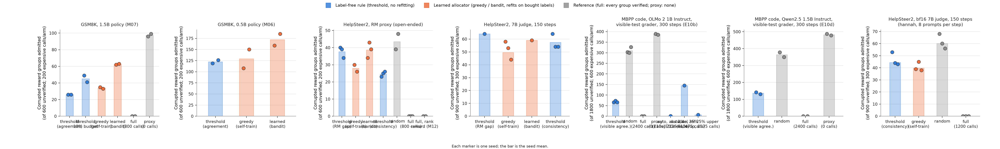
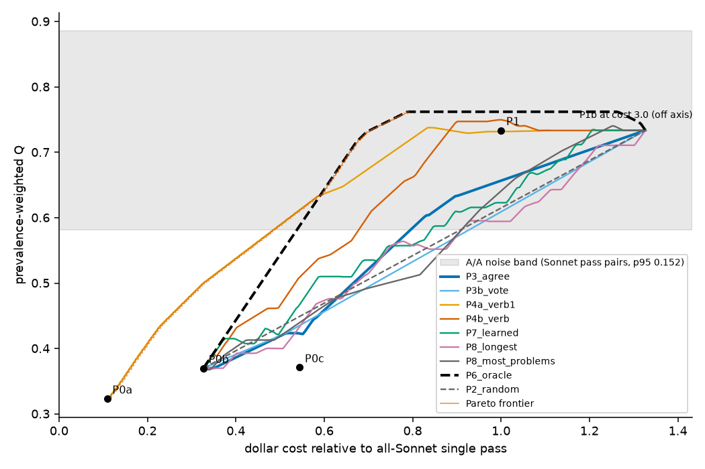

# Budgeted verification in RL post-training, and in the research loop that studied it

When a cheap grader scores every rollout group and an expensive verifier can only be afforded for a fraction of them, which groups should get the expensive call? This repository holds the pre-registered answer to that question for GRPO-style post-training (a label-free threshold on the cheap grader's own confidence matches full verification at a quarter of the calls, and no learned allocator beats it), the four-agent autonomous research loop that ran the experiments and kept the ledger, and four experiments that turn the same budgeting question on the loop itself.

<p align="center">
  
  
</p>

Left: in training, the label-free consistency threshold admits the fewest wrong rewards in every setting at equal budget. Right: the same idea applied to the loop's critic role fails, because the cheap critic's errors are systematic and agreement among its passes carries no signal.

## Key findings

1. A quarter of the expensive verifier calls, allocated to the groups where the cheap grader is least confident, gives the same held-out quality as verifying everything. Holds on GSM8K, MBPP and HelpSteer2 free text at 0.5B to 1.5B, and at 7B with two seeds (claim 1, pass).
2. A learned allocator never admits fewer corrupted rewards than that fixed rule at equal budget: it loses where the confidence signal is strong and ties where it is weak (claim 2, killed or tie in nine settings).
3. Proxy error does not cluster in prompt-embedding space on any of nine task and proxy pairs (claim 3, killed).
4. The cheap grader's error rate measured before training predicts the outcome; a short fully verified burn-in plus a regime diagnostic turns that into a budget. No cheap grader drifted over 100 to 4,000 steps.
5. Reward-model overoptimization appeared only at 7B under high optimization pressure and is judge-dependent (two of three independent judge families agree); reported as mixed.
6. On the loop itself: the planner does best with the full ledger in context (AR1); a cheap critic finds planted defects as well as a strong one but flags most clean entries, unanimously, so agreement-based escalation equals random escalation (AR3, killed, predicted by the burn-in diagnostic); and in five live copies of the loop the run-to-run variance of a single model exceeded the effect of swapping models between roles, with the planner's choice of experiment the decisive variable (AR5, unresolved by its pre-registered noise gate).
7. Routing the planner (AR6): a cheap planner costs five to ten extra experiments; consistency among cheap samples is informative here (unlike for the critic) and beats random escalation at matched budget; escalating on stalled progress fails; and routing on the state of the pre-registered claims (strong model while any claim is open, cheap model once all are settled) needs no estimator and was faster than always using the strong model in both blocks, a hypothesis for replication since it was not pre-registered.

## Results

| claim or experiment | verdict | key numbers | where |
|---|---|---|---|
| Claim 1, equal quality at 25 percent of verifier calls | pass (small scale and 7B) | 7B: threshold 7.725 / 7.76 vs full 7.645 / 7.67, bar 0.15, untrained 7.455 | `avrl/PROJECT.md`, ledger S1 entries, `avrl/runs/s1_analysis/` |
| Claim 2, learned allocator admits fewer corrupted rewards | killed where the signal is strong, tie where weak | GSM8K at 25 percent: threshold 26 vs bandit 62 to 63 vs greedy 33 to 35 per seed; free text pooled 397 vs 452 over nine comparisons | ledger M06 to M15, `lit/avrl/fig/FIGURE2.md` |
| Claim 3, edge from prompt-space structure | killed on nine pairs | embedding AUC gain at most 0.04, neighbor ratio about 1.0 | ledger E01 to E09d, `lit/avrl/fig/FIGURE1.md` |
| Drift of the cheap grader | absent in every setting | proxy-only arms flat over 100 to 4,000 steps | ledger E10c, M10, S1 |
| Overoptimization at 7B | mixed | peak 7.70 to final 7.48 under the Qwen judge; Phi-4 agrees, OLMo-2 13B reverses | ledger S1-xjudge |
| AR1, planner context | both predictions failed | experiments to verdict: full logs 5.2, compressed 7.2, compressed plus inspirations 10.2 | `avrl/runs/AR1/`, ledger AR1 |
| AR2, cheap vs strong critic | descriptive | located defects 0.72 vs 0.81; false alarms 0.50 vs 0.21; cost 12x | `avrl/runs/AR2/`, ledger AR2 |
| AR3, critic cascade | killed | cascade 0.46 vs random 0.47 vs Sonnet 0.73 quality at e = 0.25; agreement AUROC 0.58, verbalized confidence 0.86 | `avrl/runs/AR3/`, ledger AR3 |
| AR5, live routed loop | unresolved (noise gate) | two all-Sonnet copies disagree; fastest settle 5 experiments and 2.6 USD; Haiku roles cost 0.32 (ROUTED) and 0.04 (CHEAP) of all-Sonnet | `avrl/runs/AR5/`, ledger AR5 |
| AR6, planner routing policies | R1 and R4 pass, R2 and R3 fail | experiments to verdict: Sonnet 7.5, Haiku 12.9, consistency cascade 7.9 at 51 percent Sonnet picks, stall-triggered 13.8; strong-early (Sonnet while claims open) 6.9 and, with an open 7B cheap tier, 5.0 vs 7.6 in 5 of 5 seeds | `avrl/runs/AR6/`, ledger AR6 |

A two-audience write-up of the whole project is in [`avrl/SUMMARY_PAPER.md`](avrl/SUMMARY_PAPER.md). The standing of every claim is in [`avrl/PROJECT.md`](avrl/PROJECT.md). Every result above traces to a dated, pre-registered entry in [`avrl/RESEARCH_LOG.md`](avrl/RESEARCH_LOG.md).

## The autonomous research loop

[`avrl/autoresearch.workflow.js`](avrl/autoresearch.workflow.js) runs four agents per iteration, each with a JSON output schema:

| role | job |
|---|---|
| planner | reads the backlog, the ledger and the newest result files; picks the experiment with the highest information value per GPU hour under a 45-minute cap; prefers experiments that can kill a claim |
| runner | implements it by copying and modifying existing scripts, launches it detached with a done flag, polls, kills at the cap |
| analyst | reads the raw result files and appends a ledger entry: hypothesis, run, numbers table, verdict against the pre-registered pass and kill thresholds, follow-ups |
| critic | re-derives every number from the raw files, checks leakage, budget parity and seed adequacy, appends a correction note when something is wrong |

Guardrails: one GPU job at a time, writes only under one directory, no pushes, kill patterns that cannot hit the agent's own shell. [`avrl/autoresearch.live.js`](avrl/autoresearch.live.js) is the parametrized version used for AR5 (per-role models, per-run trees, optional screener cascade). [`avrl/autoresearch-routing-context.md`](avrl/autoresearch-routing-context.md) compares the loop's design with AlphaEvolve, OpenEvolve, ShinkaEvolve, AI Scientist v2 and AI co-scientist.

## Repository structure

| path | contents |
|---|---|
| `avrl/RESEARCH_LOG.md` | the ledger: append-only, pre-registered verdicts, critic notes |
| `avrl/PROJECT.md` | claims, kill tests, where the claims stand |
| `avrl/SUMMARY_PAPER.md` | short write-up for non-technical and technical readers |
| `avrl/p0_rollouts.py`, `avrl/p0_analyze.py` | phase 0: rollout sampling, structure statistics, budgeted allocation replay |
| `avrl/p1_grpo.py`, `avrl/p1_judge_grpo.py`, `avrl/p1_code_grpo.py` | phase 1 harnesses: GRPO with LoRA and a pluggable verification allocator (exact answer, judge-scored, code) |
| `avrl/allocators.py`, `avrl/judge_rewards.py`, `avrl/code_rewards.py` | allocators (threshold, greedy self-trainer, cell bandit) and reward definitions |
| `avrl/avrl_router/` | the regime diagnostic CLI (burn-in error rate, confidence AUC, budget for a corruption target) |
| `avrl/exp/` | one script per experiment, including the AR1 to AR5 harnesses and their design and pre-registration documents |
| `avrl/runs/` | result files per experiment (weights, rollout parquets and logs are not tracked) |
| `avrl/*.sh`, `avrl/*.sbatch` | launch scripts for the lab machines and the A100 node |
| `lit/avrl/` | literature sweeps (14 angles), synthesis, thesis proposal, experiment backlog, gap checks, figures |
| `SCOPE.md`, `LOOP.md`, `AGENTS.md`, `aa/`, `runs/` | an earlier project in the same repository (budgeted active audit of pretraining data), kept for provenance |

## Setup

Three Python 3.12 environments, pinned in `requirements-analysis.txt` (pandas, scikit-learn, sentence-transformers, scipy), `requirements-vllm.txt` (vLLM for rollouts and judges) and `requirements-rl.txt` (TRL and PEFT for GRPO). Create each with `python3.12 -m venv <dir> && <dir>/bin/pip install -r <file>`; the scripts expect them at `.venv`, `.venv-judge` and `.venv-rl`. Triton needs the Python headers on `CPATH`.

Models (Hugging Face ids as named in the scripts): Qwen2.5-0.5B/1.5B/3B/7B/14B-Instruct, Qwen3-0.6B-Base, Qwen3-4B, OLMo-2 1B/7B/13B, Phi-4, Skywork-Reward 0.6B. Place them under `models/`. Data: GSM8K, MBPP, HumanEval and HelpSteer2 as parquet under `avrl/data/` (loaders in the phase 0 and phase 1 scripts).

The loop experiments (AR1 to AR5) call Claude models through the Claude Code CLI in headless mode; the original loop runs inside Claude Code's Workflow tool.

Hardware used: one RTX A4000 16 GB per small-scale run; four A100 40 GB for the 7B scale-up; five A4000 workstations for the five-arm live loop.

## Reproducing the results

Phase 0, structure statistics and the allocation replay on GSM8K:

```bash
.venv-judge/bin/python avrl/p0_rollouts.py --out avrl/runs/p0
.venv/bin/python avrl/p0_analyze.py --run avrl/runs/p0
```

Phase 1, an in-training arm (threshold at a 25 percent budget, GSM8K):

```bash
.venv-rl/bin/python avrl/p1_grpo.py --arm threshold --budget 0.25 --steps 100 --seed 0 --out avrl/runs/p1_threshold_s0
```

7B scale-up on a Slurm A100 node and its analysis:

```bash
sbatch avrl/run_s1_hannah.sbatch
bash avrl/s1_collect.sh && .venv/bin/python avrl/exp/S1_analyze.py
```

Regime diagnostic on any table with a confidence column and an error column:

```bash
cd avrl && ../.venv/bin/python -m avrl_router.diagnose --groups runs/E09d/feats.parquet --confidence consistency --error proxy_error --budgets 0.1,0.25,0.5 --target_corruption rel:0.25
```

Loop experiments (each pre-registered in the ledger before its first call):

```bash
# AR1: planner-context ablation replayed on the ledger
python avrl/exp/ar1_build_oracle.py && bash avrl/exp/ar1_run_all.sh && python avrl/exp/ar1_analyze.py
# AR2: cheap vs strong critic on planted defects
python avrl/exp/ar2_critic_eval.py
# AR3: critic cascade with agreement-based escalation and a burn-in freeze
python avrl/exp/ar3_build_substrate.py && python avrl/exp/ar3_run_critic.py --workers 12
python avrl/exp/ar3_features.py --split burn --pile && python avrl/exp/ar3_analyze.py --step burn
python avrl/exp/ar3_features.py --split all && python avrl/exp/ar3_analyze.py --step test
# AR5: five live loop arms (seed build, run trees, launch, grading, audit, cost)
cat avrl/exp/AR5_LAUNCH.md
```

Each experiment's command, seeds, sample sizes and thresholds are also recorded in its ledger entry.

## Methodology

Every experiment has a ledger entry with a hypothesis, the exact run, a numbers table, a verdict against pass and kill thresholds fixed before the run, and follow-ups; an independent critic agent re-derives the numbers from the raw files and appends corrections. The loop experiments add a split-by-source burn-in and test with a frozen operating point, blind adjudication of controls, entry-clustered bootstrap intervals, and a deviations log; their design documents (`avrl/exp/AR3_DESIGN.md`, `avrl/exp/AR5_DESIGN.md`) and pre-registrations (`avrl/runs/AR3/PREREG.md`, `avrl/exp/AR5_PREREG.md`) are in the repository. Null reads are reported as unresolved with a minimum detectable effect, never as equivalence.

## Limitations

One project and one campaign are the substrate for the loop experiments. The auditor and adjudicator in AR5 are Claude models validated on seeded and planted defects only; there are no human labels. The live loop has one run per routed arm and two all-Sonnet runs, and the noise gate fired. The 7B claim-1 result still lacks the rank-shaped full-verification arm that would be its fair bound, and the overoptimization result rests on one seed. A third of the ledger entries written by the loop carried an internal contradiction that the file-based critic did not catch; they are listed, not edited.

## Citation

```bibtex
@misc{avrl-autoresearch,
  title  = {Budgeted verification in RL post-training, and in the research loop that studied it},
  author = {Dubash, Rustom},
  howpublished = {\url{https://github.com/Rustom1234/avrl-autoresearch}}
}
```

## License

MIT, see `LICENSE`.
