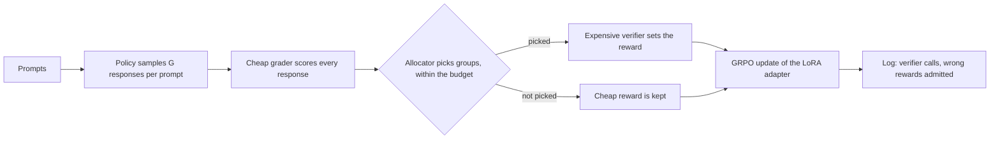
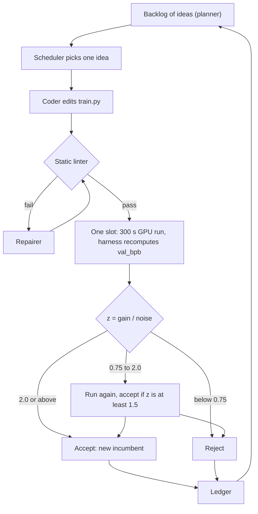

# avrl-autoresearch

**When is the expensive model, or the expensive check, worth paying for? Two preregistered studies: budgeted verification in RL post-training, and model routing in an automated research loop.**

Many training and research pipelines have two ways to do the same job: a cheap one that is sometimes wrong and an expensive one that is trusted. This repository asks when the expensive one is worth its price, in two settings.

- **Part 1 (`avrl/`)** studies reinforcement learning (RL) post-training of a language model. A cheap grader scores every response, and an expensive verifier can be afforded for only a fraction of them (the verification budget).
- **Part 2 (`loop/`)** studies an automated research loop in which language models propose and test edits to a small training script. It asks which roles in the loop need a strong model.

### The answers in brief

**Part 1.** Responses are sampled in groups, several per prompt. Spending a quarter of the verifier calls on the groups where the cheap grader is least sure (a fixed rule, called the threshold) matched full verification on held-out quality, that is, quality on prompts not used in training (7B-parameter model, two seeds). Caveat: the arm with no verifier calls scored at least as high (one evaluation's standard error is about 0.1), so the verification budget did not matter at that scale. No learned selection rule beat the threshold in training runs. Caveat: all of those runs trained models of 1.5B parameters and below; none was run at 7B.

**Part 2.** The planner (the role that chooses what to try) is the role where the strong model mattered. A cheaper coder (the role that writes the edit) showed no detectable loss and cut model spend about 8 times (model dollars only; the total falls by about 38 percent once GPU time is counted). Caveat: both statements come from the planner by coder study (P2), whose preregistered verdict is KILL. P2 contained a harm control, a loop deliberately made worse to check that the study can detect harm, and the harm control was not detected. What P2 shows is therefore secondary.

### How the evidence is controlled

- **Preregistration.** Pass and kill rules were written down before each run. The later studies also store a hash of the frozen text.
- **Split halves.** Rules that depend on the data were chosen on one half of the data and tested on the other.
- **Fresh-seed confirmation (Part 2).** Every loop's final program was rerun on fresh seeds against a sealed validation set, which the loop's models never see.

## The idea in plain language

- A model can be improved by letting it try a task many times and rewarding the good attempts. Someone has to decide which attempts were good.
- A cheap grader can make that decision for every attempt at almost no cost, but it is wrong some of the time. A careful check is right far more often and costs much more.
- Rewarding a wrong attempt teaches the model the wrong thing. The practical problem is to buy as few careful checks as possible while letting as few wrong rewards through as possible.
- The simplest rule turns out to be hard to beat: look at how unsure the cheap grader is, and send only its least sure cases to the careful check. Fancier rules that learn where the grader fails did not do better here.
- Whether any rule helps depends on how wrong the cheap grader is to begin with. If it is almost always wrong nothing saves the run, and if it is almost always right every rule looks the same. In the largest run here, skipping the careful check entirely did no measurable harm.
- Part 2 moves the same question into a different machine: a loop of language models that tries to improve a small training program by proposing an edit, running it, and keeping it if the score improved.
- In that loop the expensive resource is the strong model. One model writes the list of ideas, another turns an idea into code, others repair, vote and review. Each role could use a cheap model or a strong one.
- The loop also needs a careful check of its own: one training run is noisy, so an edit that looks better once may only be lucky. The loop reruns promising edits before it keeps them.
- The findings: the role that chooses what to try needs the strong model, and the role that types the edit did not show a need for it. These are the clearest signals in the data, but the study behind them failed its own validity check, so they are leads to replicate, not settled results. In one small test, giving a cheap reviewer more thinking time did not make its judgments more accurate.
- Both parts are one question. A cheap signal (the grader's own confidence, a role's measured reliability, a gain measured in units of noise) decides where the expensive resource goes (a verifier call, a strong model, another GPU run).

## Results at a glance

Every term is defined in the Part 1 and Part 2 sections and in the Glossary. The minimum needed to read the table:

- **Status.** PASS and KILL are verdicts of a rule fixed before the run. INCONCLUSIVE, TIE and STOP mean the fixed rule found no winner or could not decide. "Secondary" means the number is real but is not what the study's verdict rests on. A "bar" is the threshold that the fixed rule set.
- **Part 1 words.** A group is the set of responses sampled for one prompt. The policy is the model being trained (7B means 7 billion parameters). The threshold arm verifies only the groups where the cheap grader is least confident, the full arm verifies every group, and the cheap-only arm verifies none. A learned allocator (the greedy self-trainer and the bandit) is a selection rule that learns during the run where the cheap grader fails. A wrong reward is a cheap reward that disagrees with the verifier and was not replaced by it; "26 of 600" means 26 of the 600 unverified groups in a run. AUROC measures how well a signal separates wrong cases from right ones (0.5 is chance, 1.0 is perfect).
- **Part 2 words.** The score is bits per byte on validation data, lower is better. Held-out gain is the improvement of a loop's final program over the baseline on data the loop never saw. A slot is one GPU run, and every loop gets 20. In R1, arm A is the all-Sonnet control and arm D is the routed loop. A harm control is a loop deliberately made worse, to check that the study can detect harm.
- **Sources.** Codes such as M07 and E10b are entry ids in `avrl/RESEARCH_LOG.md`.

| Study | Claim tested | Number | Status | Source |
|---|---|---|---|---|
| Part 1, S1 (7B policy) | A quarter of the verifier calls, spent on the least-confident groups, matches full verification on held-out quality | Final judge score: threshold 7.725 and 7.760, full 7.645 and 7.670, untrained 7.455 (bar: gap at most 0.15) | PASS. Caveat: the cheap-only arm (no verifier calls) scored 7.810, above both (standard error about 0.1), so the budget did not matter at this scale | `avrl/runs/s1_analysis/S1_RESULT.md` |
| Part 1, GSM8K 1.5B | A learned allocator admits fewer wrong rewards than the fixed threshold at equal budget | Wrong rewards of 600, per seed: threshold 26 and 26, greedy self-trainer 35 and 33, bandit 62 and 63 | KILL | `avrl/RESEARCH_LOG.md` (M07) |
| Part 1, open-ended, 7B judge | Same claim where the confidence signal is weak | Greedy lower in 7 of 9 paired runs, pooled 397 vs 452 (bar: 8 of 9 and ratio below 0.9) | TIE (bar not met) | `avrl/RESEARCH_LOG.md` (M15) |
| Part 1, code (MBPP) | The threshold admits fewer wrong rewards than random selection at equal budget | 62 to 80 percent fewer (ratios 0.20 to 0.38, bar 0.7); held-out pass rate equal across arms | PASS on wrong rewards, no quality difference | `avrl/RESEARCH_LOG.md` (E10b, E10d) |
| Part 1, nine task and grader pairs | Cheap-grader errors cluster in prompt space (similar prompts fail together), so a learned rule could exploit them | Adding prompt embeddings to the cheap signals improves the prediction of cheap-grader error by at most 0.04 AUROC (bar 0.05) | KILL | `avrl/runs/p0/result.json`, `avrl/RESEARCH_LOG.md` (E01 to E09d) |
| Part 2, R1 (22 loops) | A routed loop loses held-out gain against an all-Sonnet control | D minus A: -0.0038 bits per byte, 90 percent interval -0.0084 to +0.0009, p = 0.18 | INCONCLUSIVE | `loop/runs/R1/analysis/report.md` |
| Part 2, P1 (re-accounting of R1) | (1) The control and the routed loop settle at different speeds. (2) A halting rule saves money. (3) Noise explains the control's failed audits | (1) A minus D slots to plateau -12.5 (interval -18.0 to -7.0). (2) Halting keeps 80 percent of loops within 0.004 at 51 percent of the dollars. (3) 23 audit rejects observed, 15 to 25 predicted | PASS, three of three | `loop/runs/R1/p1/test/report.md` |
| Part 2, P2 (60 loops) | The planner by coder factorial detects its own harm control (the validity check its preregistered verdict depends on) | Harm control not detected: one-sided log-rank p = 0.22 (needed below 0.05) | KILL | `loop/runs/P2F/RESULT.md` |
| Part 2, P2, secondary outcome | Planner tier and coder tier change held-out gain | Weak planner -0.036 bits per byte (interval -0.044 to -0.028, p below 0.001); cheap coder -0.006 (p = 0.40) at 0.13 times the model dollars (GPU time not counted) | Secondary under a KILL verdict | `loop/runs/P2F/RESULT.md` |
| Part 2, P3 (cheap critic) | More reasoning effort, or escalation to a stronger model, improves a cheap critic | Effort, high minus low: -0.028 AUROC weighted, +0.091 unweighted. Escalation: +0.168 accuracy weighted, +0.013 unweighted | No robust verdict: the two weightings disagree | `avrl/runs/P3/RESULT.md` |

## Part 1: verification-aware RL post-training

Guide and code notes: `avrl/README.md`. The directory name AVRL stands for verification-aware reinforcement learning.

### Setup

**Models and tasks.** The policy (the model being trained) is Qwen2.5 at 0.5B, 1.5B or 7B parameters, or OLMo 2 1B. Three task types are used: grade-school math word problems (GSM8K), short Python functions (MBPP), and open-ended helpfulness prompts (HelpSteer2).

**Training method.** GRPO (group relative policy optimization) samples a group of G responses to one prompt (G = 8 here) and gives each a reward. One sampled response is also called a rollout. GRPO pushes the policy toward responses that scored above their own group's average: each response's advantage is its reward minus the group mean, divided by the group's standard deviation. A group in which every response has the same reward therefore has zero advantage everywhere and contributes no gradient.

Training updates a LoRA adapter (a small set of added low-rank weight matrices, rank 32, on all linear layers) rather than the full model, at learning rate 1e-5 in all but the earliest runs and one stress test.

**Cheap grader and expensive verifier.** Every group gets a reward from a cheap grader. A chosen subset is rewarded by an expensive verifier instead.

| Task | Cheap grader | Expensive verifier |
|---|---|---|
| GSM8K | Majority vote: a response is rewarded if its answer agrees with most of its group | The gold answer |
| MBPP code | The one unit test shown in the prompt | The full set of hidden unit tests |
| HelpSteer2 | A 0.6B reward model (Skywork-Reward-V2-Qwen3-0.6B), top half of the group rewarded | A larger LLM judge (Qwen2.5 3B, 7B or 14B), reward if its score is at least 7 of 10 |

**Verification budget.** The fraction of groups per training step that may receive the expensive reward, 25 percent in most runs. One shared function (`n_verify` in `avrl/allocators.py`) turns the budget into a count per step, so every rule spends exactly the same number of calls.

**Allocators and arms.** An allocator is the rule that picks which groups are verified. An arm is one training configuration under comparison, here one allocator at one budget.

| Allocator | Rule |
|---|---|
| full | Verify every group (upper reference, 100 percent of the calls) |
| proxy (the cheap-only arm) | Verify none (lower reference, cheap grader only) |
| random | Verify a uniformly random subset |
| threshold | Verify the groups where the cheap grader is least confident. Uses no labels. Confidence is vote agreement (math, code) or how similar the group's responses are to each other (open-ended) |
| learned bandit | An online classifier predicts cheap-grader error from cheap features (signals that need no verifier call, such as vote agreement) and prompt embeddings (vectors that place similar prompts close together); Thompson sampling (see Glossary) over 100 regions of prompt space decides where to spend |
| greedy self-trainer | The same classifier, trained on the verifier labels bought so far; verify the groups with the highest predicted error |

### One training step



### What was measured

- **Wrong rewards admitted** (called corrupted rewards in the code and logs). The number of unverified groups whose cheap reward disagrees with the truth, where the truth is the expensive verifier's answer. The truth is looked up for logging only and never reaches training. Counts are written "k of N", with N the number of unverified groups in the run.
- **Held-out quality.** Accuracy, test pass rate or judge score (the LLM judge's rating on a 10-point scale) on prompts not used in training.
- **AUROC of the confidence signal.** The confidence signal is the number the threshold allocator sorts by. AUROC is the probability that a signal ranks a randomly chosen wrong case above a randomly chosen right one: 0.5 is chance and 1.0 is perfect. It was measured before training for every task and grader pair.

### Results

| Setting | Comparison at equal budget | Number | Status |
|---|---|---|---|
| HelpSteer2, 7B policy, 14B judge (S1), 4000 steps | Held-out judge score, threshold (25 percent) vs full | 7.725 and 7.760 vs 7.645 and 7.670; mean gap -0.085, bar 0.15; untrained 7.455; cheap-only arm (no verifier calls) 7.810; standard error about 0.1 | PASS, but the cheap-only arm scored highest |
| Same runs | Share of unverified groups with a wrong reward | Threshold 439 of 6000 (0.073) and 482 of 6000 (0.080); proxy 611 of 8000 (0.076) | No reduction at this scale |
| GSM8K, 1.5B policy, 100 steps, seeds 0 and 1 | Wrong rewards of 600 | Threshold 26, 26; greedy 35, 33; bandit 62, 63 | Learned rule: KILL |
| HelpSteer2, 7B judge, 9 paired runs | Wrong rewards, greedy vs threshold | 397 vs 452 pooled (ratio 0.878), lower in 7 of 9 | TIE (bar: 8 of 9 and ratio below 0.9; the bar was set after the first five comparisons were in) |
| MBPP, OLMo 2 1B Instruct, 300 steps, 3 seeds | Wrong rewards of 1800, threshold vs random | 66, 73, 66 vs 303, 300, 327 (ratios 0.22, 0.24, 0.20; bar 0.7) | PASS |
| MBPP, Qwen2.5 1.5B, 2 seeds | Same | 142, 131 vs 378, 350 (ratios 0.38, 0.37) | PASS |
| HelpSteer2, 3B judge, 2 seeds | Same, of 600 | 23, 25 vs 39, 48 (ratios 0.59, 0.52) | PASS |
| HelpSteer2, 7B judge, 5 seeds | Same | 222 vs 300 pooled (ratio 0.74) | Bar 0.7 missed |
| Nine task and grader pairs, before training | AUROC gain from adding prompt embeddings | At most 0.04 (bar 0.05) | KILL |
| All settings, 100 to 4000 steps | Cheap-grader accuracy drifting during training | Not observed | Negative |

How to read this:

- **The fixed threshold is the result that survives.** It needs no labels and no training. Where the cheap grader's confidence is informative (AUROC 0.914 for vote agreement on GSM8K) the learned rules lose to it. Where confidence is weak (0.67 to 0.69 for response similarity on open-ended prompts) the learned rule ties. These are training runs with policies of 1.5B and below; no learned rule was run at 7B. In offline replays (the allocators rerun on stored rollouts, with no training), learned rules did beat the budget-matched threshold on some open-ended measurement sets (E09d, at every budget tested), and that edge did not carry over to training (the TIE above).
- **The grader's error rate before training predicts the regime**, meaning whether selective verification can help at all. With a cheap grader wrong on about 99 percent of groups every arm ended at or below the untrained model (OLMo 2 1B base, graded by a signature vote, which rewards the programs whose output matches the group's most common output). At 7 to 8 percent error all rules tie. At 16 to 21 percent, on code, the threshold removes 62 to 80 percent of the wrong rewards that random selection lets through.
- **Fewer wrong rewards did not show up as higher held-out quality.** On code (OLMo 2 1B Instruct, seed 0, 500 held-out MBPP problems) the pass rate rose from 0.130 untrained to between 0.184 and 0.196 for every arm, the cheap-only arm included (`avrl/runs/reeval/code_hannah_e10b.md`).

### What did not work, and limits

- **The 7B PASS is narrower than it sounds.** The cheap-only arm scored 7.810 with zero verifier calls, above both threshold and full, so in this run verification did not buy judge score. The standard error of one 200-prompt evaluation is about 0.1, so the arms are not clearly separated. The full arm is also handicapped: the verifier reward is a pass mark (score at least 7), about 57 percent of its groups have identical rewards, and those groups give no gradient. A fairer full-verification arm with a rank-shaped reward (a within-group ranking, the same shape as the cheap reward) was defined and never run.
- **No learned allocator was run at 7B.** The claim that learned rules do not beat the threshold rests on the small-scale runs.
- **Prompt-space structure was not found under the preregistered rule** (KILL above), which weakens the main reason to expect a learned allocator to win. One exploratory signal sits outside that rule: in the confident subset of the largest open-ended measurement (E09d), wrong rewards were about twice as clustered as chance (neighbor ratio 2.02, permutation p below 0.001).
- **A numeric cutoff for the regime failed.** The preregistered rule "the threshold wins when cheap-signal AUROC is at least 0.85" matched 3 of 7 settings and was killed. The regime statement above is descriptive.
- **Reward-model overoptimization is mixed.** Overoptimization here means that training on the cheap reward model goes on too long, so that judged quality peaks and then falls. At a higher learning rate (3e-5) the 7B cheap-only arm peaked at 7.700 at step 1400 and averaged 7.520 over its last two evaluations (drop 0.180, bar 0.15) under the Qwen judge. Of two judges from other model families, Phi-4 agrees and OLMo 2 13B reverses the sign. One seed.
- **A follow-up question could not be tested (N3, STOP).** In Part 1, agreement among cheap votes is a good signal for when to call the verifier. In AR3 (below), agreement among a cheap critic's repeated passes was a poor signal for when the critic was wrong. N3 asked why, with the conjecture that the critic's wrong passes agree with each other. On stored data only 3 of 9 strata (subsets of the data) had enough cases (the rule needed 6), so the preregistered verdict is STOP, to be read as not tested, not as refuted. See `avrl/runs/N3/RESULT.md`.
- **Scale.** One or two seeds per arm in most settings, policies up to 7B, at most 4000 steps.

### Where the code is

| File | Role |
|---|---|
| `avrl/allocators.py` | All allocators and the shared budget function `n_verify` |
| `avrl/p1_grpo.py` | GRPO training harness for GSM8K |
| `avrl/p1_code_grpo.py`, `avrl/code_rewards.py` | Code task harness; sandboxed unit-test rewards |
| `avrl/p1_judge_grpo.py`, `avrl/judge_rewards.py` | Open-ended harness; reward-model and LLM-judge rewards |
| `avrl/p0_rollouts.py`, `avrl/p0_analyze.py` | Pre-training measurement: collect rollouts, score the confidence signals |
| `avrl/avrl_router/` | Command-line diagnostic that reads a short verified burn-in and reports the regime |
| `avrl/exp/` | Experiment and analysis scripts (`S1_analyze.py`, `n3_signal_stage0.py`, `p3_effort_analyze.py`, and others) |
| `avrl/launch/` | Shell and Slurm launch scripts |
| `avrl/runs/` | Results, one directory per run or analysis |

## Part 2: model routing in an automated research loop

Guide and code notes: `loop/README.md`. Designs and preregistrations: `loop/design/`.

### Setup

**Substrate.** The loop works on Karpathy's autoresearch setup for nanochat, pinned at commit 228791f (`loop/substrate/base/`). One file, `train.py`, may be edited. Each run trains a small language model for a fixed 300 seconds on one A100 GPU and is scored by `val_bpb`: bits per byte on a fixed validation shard (one file of the dataset), lower is better. The harness appends its own scoring code to every candidate and recomputes the metric from raw model outputs, so an edit cannot change how it is scored. A second, sealed shard is never shown to the loop's models and is used for audits and final confirmation.

**Noise.** Rerunning the unmodified script gives a standard deviation of about 0.004 bits per byte (16 launch runs: mean 1.1149, sd 0.0041). Many candidate gains are of that size, which is why acceptance needs a rule.

**Slot.** One charged GPU run: a candidate, a replicate, an audit or a crash fix. Every loop gets 20 slots.

**Roles.** The planner writes the backlog of ideas. The coder turns one idea into an edit of `train.py`. The repairer fixes edits that fail a static check (the linter, which needs no GPU run). The voter gives cheap yes or no votes on ideas. The analyst writes a short memo of what has been learned, which later prompts carry. The critic reviews a decision when the loop escalates it.

**Acceptance (the z rule).** A candidate's gain over the incumbent (the best program so far) is divided by the standard error of that difference under the measured noise. The result, z, reads as "gain in units of noise". Below 0.75 the candidate is rejected. At 2.0 or above it is accepted. In between it is run again and accepted only if z over all its runs is at least 1.5. Unusually large gains trigger an audit: an extra run on a fresh seed that can overturn the accept. Code: `loop/core/acceptance.py`.

**Ledger and scheduler.** Each loop writes a `ledger.jsonl` recording every candidate, decision and model call; all analyses read the ledgers. The scheduler keeps the backlog of ideas, gives each a prior from the cheap votes, and picks the next one by Thompson sampling: draw a plausible success rate for each idea and take the best draw.

**Fresh-seed confirmation.** After a loop ends, its final program is rerun on new seeds and scored on the sealed shard against baseline runs from the same wave (a batch of GPU jobs run side by side: confirmation runs plus one run of the unmodified baseline). Held-out gain is the baseline score minus the final program's score on that shard, so a larger gain is better.

**Arm and routing table.** An arm is one loop design. A routing table says which model fills which role and, for the coder, which model handles which class of edit (a constant change, a schedule change, a structural change). A tryout is a fixed set of test tasks for one role, run before the study to decide which models may fill it.

| R1 arm | Design |
|---|---|
| A, control | Stateless Claude Sonnet; keep an edit if one run scores lower |
| B, verified | A plus a static linter and the z rule above |
| C, scheduled | B plus a self-generated backlog chosen by Thompson sampling and a Claude Opus critic on escalation |
| D, routed | C with each role given to the cheapest model that passed a tryout: Qwen3.5-4B (constant edits, plans), Gemma 4 12B (schedule edits, votes), Claude Haiku (structural edits, repairs), Sonnet (analyst), Opus (critic) |

### One loop iteration



The diagram shows the full design, used by R1 arms C and D and by every P2 loop. Arm B has no backlog or scheduler, and arm A also has no linter and no z rule. Not drawn: the voter's votes set the scheduler's priors, the analyst's memo is carried by later prompts, and the critic reviews escalated decisions.

### Experiments, in order

**R1: four loop designs.**

- **Design.** 22 loops (A 8, B 3, C 3, D 8), 20 slots each, with the decision rule fixed in `loop/design/PREREG.md`.
- **Result.** All four arms reached about the same held-out gain (A 0.0633, B 0.0629, C 0.0607, D 0.0595 bits per byte), and the gain came from the same main edit in every arm (cutting the batch size to 2^17; 4 of the 22 loops never adopted it).
- **Status: INCONCLUSIVE.** D minus A is -0.0038 (a negative value means the routed arm gained less) with a 90 percent interval of -0.0084 to +0.0009 and p = 0.18; the rule needed p below 0.05 and an estimate beyond 0.003.
- **Caveat.** The interval is about 0.009 wide, three times the 0.003 threshold, so 8 loops against 8 could not settle a difference of this size.
- **Supporting observation.** The control's keep-if-lower rule would have kept 7.1 edits per run, of which 5.0 fail a fresh-seed audit (audits ran in every arm, the control included).
- **Source.** `loop/runs/R1/analysis/report.md`.

**P1: re-accounting of R1.**

- **Design.** No new runs. The 22 ledgers were split into a burn-in half and a test half; rules were chosen on burn-in, frozen and hashed (`loop/design/P1_PREREG.md`), then evaluated once on the test half.
- **Result: PASS on all three claims.**
  1. Arm A stops changing its incumbent 12.5 slots earlier than arm D on average (90 percent interval 7.0 to 18.0; two D loops had not settled by slot 20).
  2. Stopping a loop after 5 quiet slots (slots with no change of incumbent) following its first accepted change kept 80 percent of loops within 0.004 of their final score at 51 percent of the dollars.
  3. The control arm's 23 failed audits lie inside the 15 to 25 predicted by pure noise.
- **Caveats.** A and D differ in acceptance rule and scheduler as well as in models, so claim 1 says the arms differ, not that model tier causes it. There are four loops per arm in each half. The halting rule led its runner-up by a thin margin on burn-in.
- **Source.** `loop/runs/R1/p1/test/report.md`.

**P2: planner by coder factorial with a harm control.**

- **Design.** 60 loops in 12 randomized blocks, each block holding one loop from each of five cells, so 12 loops per cell (`loop/design/P2_PREREG.md`). A cell is one combination of planner and coder. The planner is either Sonnet or Qwen3.5-4B. The coder is either Sonnet or the cheap table, which is the R1 routing for the coder: Qwen3.5-4B for constant edits, Gemma 4 12B for schedule edits, Haiku for structural edits and repairs. That gives four cells (the factorial). A fifth cell, H, is the harm control: it is the all-Sonnet cell with half of the coder's new edits replaced by a do-nothing edit, and it exists to show that the study can detect a loop that has been made worse.
- **Outcomes.** The first outcome is the stall: a loop whose final program still has the large batch size, meaning it never adopted the one change every successful loop found. The second is the number of slots a loop needs to reach the small batch size.
- **Result: KILL.** H was not detected as slower than the all-Sonnet cell in slots to reach the small batch (one-sided log-rank test, which compares how soon two sets of loops reach an event: p = 0.22, needed below 0.05). The preregistration ranks KILL above every other verdict, so it stands whatever the other numbers show. The endpoint had too few events: the all-Sonnet cell itself reached the small batch in only 5 of 12 loops.
- **Source.** `loop/runs/P2F/RESULT.md`.

| Cell | Planner | Coder | Stalled | Held-out gain | Accepts per loop | Model USD per loop | GPU hours per loop |
|---|---|---|---|---|---|---|---|
| SS | Sonnet | Sonnet | 7 of 12 | 0.0545 | 2.17 | 1.43 | 2.27 |
| ST | Sonnet | cheap table | 6 of 12 | 0.0560 | 2.08 | 0.25 | 2.08 |
| QS | Qwen3.5-4B | Sonnet | 9 of 12 | 0.0257 | 1.25 | 1.66 | 2.22 |
| QT | Qwen3.5-4B | cheap table | 11 of 12 | 0.0124 | 0.67 | 0.15 | 1.56 |
| H | Sonnet, half of edits withheld | Sonnet | 9 of 12 | 0.0328 | 1.17 | 1.45 | 2.29 |

What the secondary outcomes show, all to be read under the KILL verdict:

- **Planner.** Qwen-planned loops gained 0.036 bits per byte less than Sonnet-planned loops (24 against 24, 90 percent interval 0.028 to 0.044, p below 0.001, same direction in 11 of 12 blocks). Their stall rate was 0.29 higher (20 of 24 against 13 of 24, Fisher exact test p = 0.060), above the 0.25 margin that the preregistration set for calling the cheap tier harmful.
- **Coder.** The cheap table lost 0.006 bits per byte of held-out gain (interval -0.017 to +0.006, p = 0.40, not significant) at 0.13 times the model dollars (model dollars only; with GPU time counted the total falls by about 38 percent, see Cost). Per backed change (an accepted edit that rests on at least two runs with different seeds) the all-cheap cell QT was 2.5 times cheaper than SS, short of the 5 times a PASS required, and that ratio rests on only 4 backed changes. The coder result is "no detectable effect", not "harmless": with a Qwen planner the cheap coder trended worse (QT minus QS -0.013, p = 0.12).
- **Mechanism.** Sonnet planners put the batch-size cut in every initial idea list (36 of 36); Qwen planners did in 10 of 24. All 14 Qwen-planned loops that never tried it stalled. The planner tryout had rated all five candidate models 12 of 12, because it checked only the format of the reply.
- **Harm control, after the fact.** H lost 0.022 bits per byte of held-out gain against SS (p = 0.005). This was not the preregistered endpoint and does not change the verdict.
- **Deviation.** Every Claude call was refused (HTTP 403) for about two hours during the run. The 28 affected loops were rerun from scratch with identical configurations; the planner effect is -0.0365 on the 32 untouched loops and -0.0355 on the reruns.

**P3: reasoning effort for a cheap critic.**

- **Design.** Haiku reviewed 299 stored experiment write-ups from AR3 (below), most of them with a planted error, at four reasoning-effort levels (1,196 calls, about 1.70 USD), with tests fixed in advance on a held-out split of 224 items. Two questions were asked: does more effort help, and does escalating to a stronger model help.
- **Result: no robust verdict.** The two preregistered weightings disagree on both questions. The weighted view (primary) gives the correct write-ups most of the weight; the unweighted view counts every item once.
- **Descriptively.** Accuracy was flat from low to high effort (0.82 to 0.81) while cost per call rose 1.9 times, and Haiku judged correct write-ups correctly 8 of 34 times at low effort against 2 of 34 at high.
- **Caveat.** One model, one task, 34 clean items; the false-alarm pattern is post hoc.
- **Source.** `avrl/runs/P3/RESULT.md`.

**Requalification of Haiku.** Before P2, Haiku was retested on the two jobs the routing table gives it. Result: 30 of 30 structural edits (Wilson lower bound 0.886, bar 0.75) and 20 of 20 lint repairs (0.839, bar 0.6), 100 calls in all, so it kept both roles. The Wilson lower bound is the low end of a confidence interval on the pass rate. Caveat: the test items were written within this project, without sight of Haiku's answers, and not taken from an independent source, so they may suit Claude models better than an independent set would; the abort path (the coder's option to decline an edit) was not tested. Source: `loop/runs/calibration_requal/RESULT.md`.

### Cost

**In model dollars, routing is cheap.**

- R1: the routed arm D cost 0.24 USD per loop, against 1.44 for the same loop without routing (arm C, about 6 times less) and 0.78 for the control (arm A).
- P2: the cheap coder table cost 0.13 times the Sonnet coder (about 8 times less).

**Model dollars are not the whole bill.**

- Calls to open-weight models are priced at hosted list prices (`loop/models/open_prices.json`) although they ran on local GPUs.
- Each R1 loop also used about 2.1 to 2.3 A100-hours of training. At 2 USD per A100-hour the R1 totals per loop are A 5.42, B 5.64, C 6.05 and D 4.49, so routing saves 17 percent against the control and 26 percent against the unrouted loop (arm C). In P2 the cheap coder table cuts the total by about 38 percent.
- Renting dedicated GPUs to serve the open-weight models for the whole 13.8 hour R1 run would have cost 9.38 to 13.80 USD. That is about as much as or more than the model dollars the eight routed loops saved (9.59 USD against the unrouted design, 4.29 USD against the control), so the saving holds only when those models run on owned or shared hardware.

Sources: `loop/runs/R1/analysis/cost_report.md`, `loop/runs/R1/p1/all/report.md`, `loop/runs/P2F/RESULT.md`.

### Where the code is

| File | Role |
|---|---|
| `loop/core/arms.py`, `loop/core/run_loop.py` | Loop engine: one slot at a time, resumable from a state file |
| `loop/core/acceptance.py` | The z rule, the audit tripwire, integrity checks |
| `loop/core/scheduler.py`, `loop/core/prompts.py` | Backlog, Thompson sampling, role prompts |
| `loop/core/linter.py`, `loop/core/patch.py` | Static checks and edit application |
| `loop/core/ledger.py`, `loop/core/controller.py` | Ledger writer; run controller (plan, baseline runs, launch of many loops) |
| `loop/core/confirmation.py`, `loop/core/calibration.py` | Fresh-seed confirmation block; per-role model tryouts |
| `loop/core/analysis.py`, `loop/core/analysis_p2.py`, `loop/core/cost_report.py` | Preregistered analyses and cost accounting |
| `loop/models/` | Model call layer (`call.py`), model list and prices, cost accounting, spend guard |
| `loop/substrate/` | GPU job queue, worker, scoring harness, pinned nanochat base |
| `loop/p1/reaccount.py` | The P1 re-accounting study |
| `loop/design/` | Design documents, preregistrations and their hashes, runbooks |
| `loop/runs/` | Results: `R1`, `P2F`, `calibration`, `calibration_requal`, and supporting runs |

## Earlier loop experiments (AR1 to AR6)

Before the nanochat study, the same question was asked of single roles in a research loop on a different task. That loop planned and reviewed a series of post-training experiments, with the Part 1 experiment records as test material. The questions: does the planner need full context, and do the planner and the critic need a strong model.

These experiments are smaller, and most replay stored records offline rather than running live. The usual score for a planner is the number of experiments it needs before the loop reaches a verdict (fewer is better). Scripts are in `avrl/exp/` (prefixes `ar1` to `ar6`), results in `avrl/runs/AR1` to `avrl/runs/AR6`. There is no AR4.

| Id | Question | Verdict |
|---|---|---|
| AR1 | Does the planner do as well with a compressed history as with full logs? | KILL: experiments needed to reach a verdict were 5.2 with full logs, 7.2 compressed, 10.2 compressed plus inspirations |
| AR2 | Does a strong critic find more planted defects than a cheap one? | Inconclusive (one of two preregistered readings met). Strong vs cheap: defects located 0.81 vs 0.72, false alarms 0.21 vs 0.50, 12 times the cost. The strong critic buys fewer false alarms more than extra detections |
| AR3 | Can a cheap critic escalate to a strong one when its own passes disagree? | KILL: critic quality 0.46 with the cascade, 0.47 with random escalation, 0.73 with Sonnet alone. Agreement AUROC 0.58; stated confidence 0.86 |
| AR5 | Does a live loop with cheap models in some roles match an all-Sonnet loop? (five arms, one 8-hour block) | Unresolved: two all-Sonnet runs disagreed with each other, so the preregistered noise gate blocked any verdict |
| AR6 | Which planner routing policies work? (replayed offline) | Two of four preregistered predictions pass. Experiments to verdict: Sonnet 7.5, Haiku 12.9, consistency cascade 7.9 with 51 percent Sonnet picks, stall-triggered escalation 13.8 |

## Glossary

- **Allocator.** The rule that picks which groups of responses get the expensive verifier.
- **Anchor.** The unmodified baseline program, run several times before launch to measure the starting score and the noise.
- **Arm.** One configuration under comparison: one allocator in Part 1, one loop design in Part 2.
- **Audit.** In Part 2, an extra run of a candidate on a fresh seed that can overturn an accept.
- **AUROC.** Probability that a signal ranks a random wrong case above a random right one. 0.5 is chance.
- **Backed change.** In P2, an accepted edit that rests on at least two runs with different seeds.
- **Block.** In P2, a set of five loops, one per cell, in random order.
- **Burn-in half, test half.** A split of the data. Rules are chosen on burn-in and judged once on test.
- **Cell.** In P2, one combination of planner and coder (SS, ST, QS, QT), or the harm control H.
- **Cheap grader (proxy).** The low-cost reward source applied to every response.
- **Cheap-only arm (proxy arm).** The Part 1 arm that never calls the verifier.
- **Corrupted reward (wrong reward).** A cheap reward that disagrees with the truth and was not replaced by the verifier.
- **Group.** The G responses sampled for one prompt in one training step.
- **GRPO.** Group relative policy optimization: reward each response relative to the other responses to the same prompt.
- **Harm control.** An arm that is deliberately made worse, to check that the study can detect harm at all.
- **Held-out gain.** Baseline score minus the final program's score on the sealed shard, on fresh seeds.
- **Incumbent.** The best program accepted so far in a loop.
- **Ledger.** The append-only record of every candidate, decision and model call in a loop.
- **LoRA.** Low-rank adaptation: train small added matrices and leave the base weights frozen.
- **Model dollars.** Spend on model calls at list price. Excludes GPU time for training runs.
- **Policy.** The model being trained in Part 1.
- **Preregistration.** Predictions, tests and pass or kill thresholds written down before the data are seen. The later studies also store a hash of the frozen text.
- **Regime.** In Part 1, whether selective verification can help in a setting, which depends on how often the cheap grader is wrong.
- **Rollout.** One sampled response.
- **Routing table.** The assignment of models to roles and to classes of edit.
- **Sealed shard.** Validation data that the loop's models never see, used for audits and final confirmation.
- **Sentinel.** A rerun of the unmodified program during a study, used to track noise and drift.
- **Slot.** One charged GPU run in a loop. Each loop has 20.
- **Stall.** A loop whose final program never adopted the batch-size cut (batch still above 2^17).
- **Thompson sampling.** Choose by drawing a plausible value for each option from what is known so far and taking the best draw. Uncertain options are tried sometimes; proven ones are tried often.
- **Threshold allocator.** Verify the groups where the cheap grader is least confident. No labels, no training.
- **Tryout.** A fixed set of test tasks for one role, run before a study to decide which models may fill that role.
- **val_bpb.** Validation bits per byte. Lower is better.
- **Verification budget.** The fraction of groups per step that may receive the expensive reward.
- **Verifier.** The trusted, expensive reward source.
- **z.** A gain divided by its standard error under the measured run-to-run noise.

## Repository layout

```
README.md                  this file
LICENSE                    MIT
requirements-analysis.txt  analysis environment
requirements-rl.txt        GRPO training environment
requirements-vllm.txt      inference server environment
avrl/                      Part 1: verification-aware RL post-training
  README.md                guide to Part 1
  allocators.py            allocators and the budget function
  p1_grpo.py, p1_code_grpo.py, p1_judge_grpo.py    training harnesses
  code_rewards.py, judge_rewards.py                reward sources
  p0_rollouts.py, p0_analyze.py                    pre-training measurement
  avrl_router/             regime diagnostic
  exp/                     experiment and analysis scripts, AR1 to AR6, N3, P3
  launch/                  shell and Slurm launch scripts
  runs/                    results
loop/                      Part 2: model routing in an automated research loop
  README.md                guide to Part 2
  core/                    loop engine, acceptance, scheduler, ledger, analyses
  models/                  model call layer and prices
  substrate/               GPU workers, scoring harness, pinned nanochat base
  p1/                      re-accounting study of R1
  design/                  designs and preregistrations
  runs/                    results
archive/                   files outside the core project: an earlier project in the same repository, reading notes
```

## Reproducing

**Environments.** Three Python 3.12 virtual environments, one per requirements file:

| Environment | Requirements file | Used for |
|---|---|---|
| `.venv` | `requirements-analysis.txt` | Analyses, the loop engine, tests |
| `.venv-judge` | `requirements-vllm.txt` | vLLM for Part 1 rollouts and LLM judges |
| `.venv-rl` | `requirements-rl.txt` | GRPO training (TRL and PEFT); also the vLLM servers for the loop's open-weight models |

**Hardware.** One node with four A100 40GB GPUs (7B training and all nanochat runs) and workstation GPUs with 16GB of memory, plus one with 32GB (small-scale training and the open-weight model servers).

**Model calls.** Anthropic models are called through the `claude` command-line client in headless mode; open-weight models are called through a vLLM OpenAI-compatible server. In Part 2 both paths go through `loop/models/call.py`.

**Tests.** Run each suite in its own process (a single combined invocation fails at collection):

```bash
for d in loop/core/tests loop/models/tests loop/substrate/tests loop/p1/tests avrl/exp/n3_tests avrl/exp/p3_tests; do
  .venv/bin/python -m pytest "$d" -q
done
```

**Regenerating the main analyses from stored run data.** No GPU or model call is needed.

```bash
# R1: preregistered analysis and cost report
.venv/bin/python -m loop.core.analysis --run loop/runs/R1 --out loop/runs/R1/analysis
.venv/bin/python -m loop.core.cost_report --run loop/runs/R1 --calibration loop/runs/calibration

# P1: re-accounting, burn-in half and then the frozen test-half run
.venv/bin/python loop/p1/reaccount.py --half burnin
P1_ALLOW_TEST=1 .venv/bin/python loop/p1/reaccount.py --half test --rule after_first:5

# P2: factorial analysis
.venv/bin/python -m loop.core.analysis_p2 --run loop/runs/P2F --out loop/runs/P2F/analysis
```

The Part 1 summaries are produced by `avrl/exp/S1_analyze.py` (7B runs, output in `avrl/runs/s1_analysis/`), `avrl/exp/n3_signal_stage0.py` (N3) and `avrl/exp/p3_effort_analyze.py` (P3). `S1_analyze.py` takes `--runs_dir` and `--out`, `p3_effort_analyze.py` takes `--run-dir`, `--ar3-dir` and `--out`, and `n3_signal_stage0.py` reads and writes fixed locations under `avrl/runs/`. The raw per-step training logs of Part 1 (`*.jsonl` files under `avrl/runs/`) are excluded from version control, so the S1 summary cannot be rebuilt from a fresh clone; its committed output and the experiment log carry the numbers.

## Limitations

- **Scale.** Policies up to 7B parameters and at most 4000 training steps in Part 1; a five-minute training task in Part 2.
- **Seeds.** One or two seeds per arm in most Part 1 settings. Eight loops per arm at most in R1, twelve per cell in P2.
- **Single substrate.** All Part 2 results come from one training script and one metric. One edit (the batch-size cut) explains most of the variation in gain (78 percent of the variance in P2), so the task may be too simple to separate loop designs.
- **Model dollars versus GPU time.** The 6 to 8 times saving is in model dollars. GPU time was the larger cost, and with it the saving is 17 to 38 percent. Open-weight calls are priced at hosted list prices, not at the cost of the hardware that served them.
- **The P2 verdict is KILL.** Its harm control was not detected on the preregistered endpoint. The planner and coder effects are secondary outcomes and should be treated as strong leads for a replication, not as confirmed results.
- **Quality did not follow wrong-reward counts in Part 1.** Fewer wrong rewards did not produce a measurable gain in held-out quality at the scales tested, and the cheap-only arm scored highest in the 7B run.
- **Confounded arms in R1.** Arms differ in several components at once, so differences between arms cannot be assigned to model choice alone.
- **Judges and test items are models too.** Open-ended quality is an LLM judge's score, and one overoptimization result changes sign with the judge family.

## License

MIT. See `LICENSE`.

Contact: Rustom Dubash, rdubash@haverford.edu
