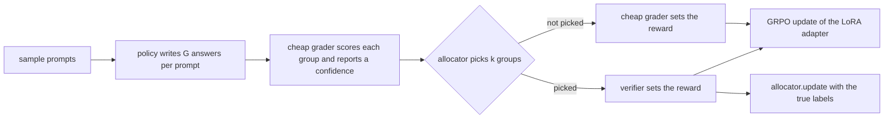

# Part 1: which rollouts deserve the expensive check

Paths in this file are relative to this folder (`avrl/`). Commands say where to run them from.

## The question and the answer

Reinforcement-learning post-training of a language model needs a reward for every sampled answer. The reward that can be trusted (a reference answer, a full test suite, a large judge model) is usually the expensive part. A cheap substitute (a majority vote, one visible test, a small reward model) costs almost nothing and is sometimes wrong.

**Question.** If only a fraction of the answers can go to the expensive verifier and the rest get the cheap, noisy grader, which answers should be verified? And does a rule that learns where the cheap grader fails beat a fixed rule?

**Answer.** No. The fixed rule studied here is the threshold allocator: verify the groups of answers on which the cheap grader is least confident. A learned allocator did not beat it in any setting where the confidence signal carried information.

The three findings behind that answer, each with its main caveat (numbers and sources are under "Main results"):

1. **Cost.** With 25 percent of the verifier calls, the threshold rule gave held-out quality (the score on prompts never trained on) within noise of verifying everything. Caveat: so did verifying nothing. The measured benefit is fewer wrong rewards admitted into training, not a higher final score.
2. **Learned against fixed.** The one learned-allocator win (experiment M08a) was over a threshold ranked by a near-random signal, and it did not hold against a threshold ranked by a better signal (M09).
3. **Signal quality.** The threshold rule is only as good as its confidence signal. On the code task it admitted 62 to 80 percent fewer corrupted groups (groups trained on a wrong reward) than random selection; ranked by a near-chance signal on the open-ended task it did the same as random.

Scale: policies of 0.5B to 7B parameters on three tasks (GSM8K math word problems, MBPP Python problems, open-ended helpfulness on HelpSteer2 prompts). Seed counts are given with each result.

The folder also keeps the early experiments on an automated research loop (AR1 to AR6), which ask the same question about the LLM roles of that loop and led to Part 2 in `../loop/`.

## Terms used below

| term | meaning |
|---|---|
| policy | the language model being trained |
| rollout, group | one sampled answer is a rollout; the G answers sampled for one prompt form a group |
| GRPO | group relative policy optimization: an answer is pushed up or down according to its reward relative to the other answers in its group |
| LoRA | low-rank adapter: small trainable matrices added to a frozen model (here rank 32 on all linear layers) |
| cheap grader | a fast reward that needs no labels and is sometimes wrong (a majority vote, one visible test, a small reward model) |
| expensive verifier | the reward that is trusted (reference answer, full hidden test suite, a larger judge model) |
| verification budget | the fraction of groups per step that may go to the verifier; 0.25 in most runs |
| allocator | the rule that picks which groups are verified |
| arm | one configuration in a comparison, here one allocator; arms share model, data, seed and budget |
| corrupted group | an unverified group whose cheap reward is wrong according to the verifier; computed for logging only |
| confidence signal | a number the cheap grader gives for free that should be low when it is wrong, for example the share of answers that agree |
| cheap features | the confidence signal plus other label-free numbers computed from the group and its prompt; for GSM8K the list is `agreement`, `n_distinct`, `mean_len`, `std_len`, `frac_truncated`, `q_len` (documented in `allocators.py`) |
| AUROC | the probability that a wrong group has lower confidence than a right one; 0.5 is chance, 1.0 is perfect |
| held-out | prompts never trained on, used only to score the trained model |
| untrained | the policy before any training step, the baseline for held-out scores |
| pass@1 | on the code task, the share of problems solved by one generated program |
| replay | running allocators over recorded rollouts, with no training |
| task point | one recorded set of rollouts (one task, policy model and cheap grader) |
| preregistered | pass and kill thresholds were written before the run; PASS and KILL below refer to them |
| bar | the preregistered threshold a number has to clear |
| ledger | `RESEARCH_LOG.md`: one dated entry per experiment id (E01, M07, S1 and so on) with setup, numbers and verdict |
| a / b | values for seed 0 then seed 1 unless a row says otherwise |

## How one training run works

### One step in plain words

At every step the policy writes G answers to each of a few prompts. The cheap grader scores every group and also reports how confident it is. The allocator then spends the step's verification budget: it picks k groups, and those get their reward from the verifier. Every other group keeps the cheap reward, right or wrong. GRPO trains on the mix. Last, the verified groups, now with their true labels, are handed to the allocator. This is the only training data a learned allocator gets.

Two quantities are tracked in every run:

- **Corrupted groups** (lower is better): unverified groups whose cheap reward was wrong, that is, wrong rewards the policy trained on.
- **Held-out quality**: the trained policy's score on prompts it never trained on.

An allocator is better if it admits fewer corrupted groups for the same number of verifier calls. Whether that also changes held-out quality is a separate question (result 1 below).



### The same run in code

All three training scripts run the same loop. Function names are for `p1_grpo.py` (GSM8K); the other two scripts mirror it. Steps 1 and 2 happen once per run, steps 3 to 8 at every training step.

1. **Load data and prompt features.** `load_gold` reads the reference answers. `compute_prompt_feats` embeds every training prompt with MiniLM (a small sentence-embedding model), keeps 16 principal components and assigns one of 100 k-means cells (regions of prompt space). Only the learned allocators use these.
2. **Build the trainer.** `build_grpo_config` builds the `GRPOConfig` of the Hugging Face TRL library (sampling temperature 1.0), and `main` attaches a LoRA adapter (`--lora_r`, default 32) and creates the `GRPOTrainer`. Each step draws `--prompts_per_step` prompts and samples `--G` answers per prompt, in an order fixed by `--seed`.
3. **Cheap grade.** The trainer calls `RewardState.__call__` with all answers of the step. `RewardState._group_record` parses each answer (`extract_answer`, `normalize`), takes the majority answer of the group as the cheap label, and records the confidence (`agreement`, the share of the G answers that give the majority answer).
4. **Decide how many to verify.** `allocators.n_verify(n_groups, budget)` returns the count k. It is one pure function shared by all arms, so every arm at a budget spends the same number of verifier calls.
5. **Decide which.** `allocator.select(records, k, rng)` returns k group indices. The records passed in have the reference answer removed.
6. **Assign rewards.** In a verified group an answer gets reward 1 if it equals the reference answer. In an unverified group it gets 1 if it equals the majority answer.
7. **Log and learn.** One row per step goes to `log.jsonl` (`expensive_calls`, `corrupted_reward_groups`) and one row per group to `groups.jsonl`. `allocator.update(verified)` then hands the verified groups, now with their true labels, to the allocator.
8. **Update and evaluate.** GRPO updates the adapter. `PeriodicEval` scores a held-out subset of the test file every `--eval_every` steps, and `TimeLimit` stops a run at `--max_hours`.

### The three training scripts

The tasks differ only in what plays the cheap grader, the verifier and the confidence signal.

| script | task | cheap grader | expensive verifier | confidence signal |
|---|---|---|---|---|
| `p1_grpo.py` | GSM8K math word problems | majority vote over the group's final answers | exact match with the reference answer | vote agreement |
| `p1_judge_grpo.py` (helpers in `judge_rewards.py`) | open-ended helpfulness on HelpSteer2 prompts | a 0.6B reward model (`RewardModelScorer`); reward 1 if the score is above the group median (`proxy_rewards`) | an LLM judge scores each answer 1 to 10 against a rubric (`HFJudge`); reward 1 at 7 or more (`gold_rewards`) | `--threshold_feature consistency` (mean pairwise similarity of the answers' MiniLM embeddings) or `gap` (gap between the top two reward-model scores) |
| `p1_code_grpo.py` (helpers in `code_rewards.py`) | MBPP Python problems | `--proxy visible`: the program passes the one test shown in the prompt; `--proxy signature`: majority vote over program outputs | all hidden tests in a sandbox (`run_batch`, worker `exp/_e10_verify_worker.py`) | with `--proxy visible`, the share of visible-test passers that produce the same outputs (`visible_signature_stats`); with `--proxy signature`, the share of the group that gives the most common outputs (`group_signature_stats`) |

Two reward shapes appear on the open-ended task. The judge reward above is absolute (1 at a score of 7 or more, whatever the rest of the group scored). The cheap reward is rank-shaped (1 if above the group median). A rank-shaped judge reward also exists (`rank_gold_rewards`: 1 if the judge score is strictly above the group median); it matters for one caveat under result 1.

Other differences:

- The judge script calls `n_verify` with the step index, so that fractional budgets add up over steps (0.25 of 2 groups becomes 1 group on alternate steps). It also makes one judge call per unverified group for logging; those calls are counted separately and are not part of the budget.
- The code script accepts `--budget auto`: it verifies everything for `--burnin_steps` steps (the burn-in), runs the AUROC diagnostic (`avrl_router.diagnose`, described under "How to run") on those groups, and sets the budget from the result.
- Held-out metrics: the code script reports pass@1 on MBPP at every evaluation, plus HumanEval (a second Python benchmark) at the final step (`CodeEval`); the judge script reports the mean judge score on held-out prompts (`JudgeEval`).

Rules that keep arms comparable: the same `n_verify` for every arm, allocators never see the verifier's label before selecting, a learned allocator trains only on groups it paid to verify, prompt order depends only on the seed, and evaluation prompts come from a separate file.

## The allocators

All six are classes in `allocators.py`, registered in `ALLOCATORS` and chosen with `--arm`. Each has three methods: `n_verify`, `select` and `update`. Two are references, one is a control, one is the fixed rule, two are learned.

| `--arm` | rule | inputs | verifier calls | role |
|---|---|---|---|---|
| `full` | verify every group | none | one per group | the reference for quality |
| `proxy` | verify nothing; every reward comes from the cheap grader | none | zero | the reference for what the cheap grader alone does |
| `random` | verify k groups chosen uniformly at random | the random generator | budget times groups | the control that shows whether a confidence signal adds anything |
| `threshold` | sort groups by confidence and verify the k least confident (`ThresholdAllocator._order`; ties go to the group with more distinct answers) | the confidence signal only | budget times groups; no fitting, no labels | the fixed rule |
| `greedy` | a classifier predicts the cheap grader's error; verify the k groups with the highest predicted error probability; no cells, no sampling | cheap features, prompt embedding, labels of verified groups | budget times groups, plus the refits | learned rule without prompt cells |
| `learned` | the same classifier plus a bandit over prompt cells (below) | as greedy, plus the cell id | budget times groups, plus the refits | learned rule with prompt cells |

The classifier behind both learned arms is an online logistic regression. It predicts the cheap grader's error from the cheap features plus the 16 prompt-embedding components, and is refit after every 20 newly verified groups, on verified groups only.

The `learned` arm adds exploration by region of prompt space. Each prompt cell keeps a Beta posterior over its error rate, seeded by the classifier. Thompson sampling picks the groups: each group draws a rate from its cell's posterior and the highest draws are verified, so uncertain regions get explored. Until the first fit the arm behaves like threshold.

## Main results

How to read this section:

- Unless noted, counts are corrupted groups over a whole run at a 25 percent budget (lower is better), and the source is the ledger entry with that id. Ids in parentheses (M07, E10b and so on) are rows of the experiment index that follows this section.
- Per-step logs are not stored in the repository (see "How to run").
- `PROJECT.md` tracks three claims, and the results map onto them. Claim 1: equal quality at a fraction of the verifier calls (result 1). Claim 2: a learned allocator admits fewer corrupted rewards than any fixed rule (result 2). Claim 3: the cheap grader's errors cluster in regions of prompt space, which a learned allocator could exploit (result 4, first item).

### 1. A quarter of the verifier calls gives the same held-out quality as all of them: PASS on every task, with the exceptions listed under Caveats

| setting | threshold at 25 percent | full verification | untrained | source |
|---|---|---|---|---|
| GSM8K, Qwen2.5-1.5B-Instruct, accuracy on 300 problems, seeds 0 and 1 (M07, M10) | 0.657 / 0.690 | 0.680 / 0.690 | 0.583 | `runs/reeval/gsm8k.md` |
| MBPP, OLMo 2 1B Instruct, pass@1 on 500 problems (E10b) | 0.194 / 0.194 (seeds 1, 2) | 0.190 (seed 1) | 0.130 | `runs/reeval/code.md`, ledger REEVAL-code |
| open-ended, Qwen2.5-1.5B-Instruct, 3B judge, mean score on 200 prompts, seeds 0, 1, 3 | 8.585 / 8.55 / 8.38 | 8.71 / 8.55 / 8.57 | 8.13 | ledger REEVAL-judge |
| open-ended, Qwen2.5-7B-Instruct, 14B judge, 200 prompts, seeds 0 and 1 (S1) | 7.725 / 7.760 | 7.645 / 7.670 | 7.455 | `runs/s1_analysis/S1_RESULT.md` |

The first three rows are re-evaluations of the saved adapters on one fixed held-out subset per task (REEVAL). The ledger verdicts on the preregistered tests:

- GSM8K (M10): PASS, judged on the in-training evaluations.
- Code (E10b): PASS, judged on the in-training evaluations (threshold 0.205 against full 0.220 on seed 0 and 0.235 against 0.205 on seed 1). The ledger words this as within 2 points of full, although on seed 1 the gap is 3 points in the threshold's favor.
- Open-ended, 3B judge: PASS (three-seed mean gap 0.105 against a bar of 0.15; per-seed gaps 0.125, 0.00 and 0.19).
- S1: PASS (gap -0.085, threshold ahead, same bar).

Caveats:

- **Zero verification did as well on the same measures**: GSM8K 0.663 / 0.690, MBPP 0.192, S1 7.810 (one seed). The ledger's own reading is that budget and allocation rule do not move held-out quality on any of the three tasks at these scales; they move only the number of wrong rewards the policy was trained on. So this is a result about cost at equal quality, not evidence that verification improves these policies.
- **Evaluation noise is large next to the gaps**: standard error about 2.7 points on 300 GSM8K problems, 1.8 points on 500 MBPP problems, about 0.1 judge points on 200 prompts.
- **Two of the tests did not pass as first written.**
  - On the 3B-judge task the first preregistered test (threshold within 0.15 of full on each seed, M11) failed on seed 0 (4.68 against 4.92) and was recorded as inconclusive over two seeds; the PASS comes from the later three-seed mean test (M13) and from a full arm trained with a rank-shaped reward (M12). The 4.68 and 4.92 are in-training evaluation scores. They are on a different scale from the table because that evaluation scored answers cut off at 6 tokens, and the ledger later declared it void for this task and replaced it with the re-evaluation shown in the table (ledger, BUG note of 2026-10-02 22:50 UTC).
  - On the second code policy (Qwen2.5-1.5B-Instruct, E10d) the threshold arm ended 2.5 points below full on in-training MBPP on seed 0 (0.445 against 0.470), which the ledger records as within noise, not a pass by the letter.
- **Two caveats specific to S1.** The judge is from the same model family as the policy. The full arm trains on an absolute reward that is identical within about 57 percent of its groups, which gives it less to learn from (GRPO learns from reward differences inside a group, and such a group has none). A fairer rank-shaped full arm is defined in `launch/run_s1_hannah.sbatch` (job d) and was never run.

### 2. A learned allocator did not beat a threshold that ranks by an informative signal: negative on GSM8K, tie on the open-ended task

Cells are corrupted groups (lower is better). Of the 800 groups in a run, 200 are verified at the 25 percent budget and 600 are not (in M07, 100 steps of 8 groups).

| setting | threshold | greedy | learned | status |
|---|---|---|---|---|
| GSM8K 1.5B, 800 groups (M07) | 26 / 26 | 35 / 33 | 62 / 63 | KILL for the learned allocators |
| GSM8K 0.5B, 800 groups (M06, M06b) | 119 / 126 | 108 / 150 | 159 / 185 | KILL for learned; greedy inconclusive |
| open-ended, 3B judge, 800 groups (M08a, M09) | 40 / 39 ranked by reward-model gap; 23 / 25 ranked by consistency | 30 / 26 | 34 / 43 | PASS for greedy against the gap-ranked threshold (M08a); KILL for greedy against the consistency-ranked threshold (M09) |
| open-ended, 7B judge, nine paired runs pooled (M15) | 452 | 397 | not run | TIE |

How to read the two open-ended rows:

- **3B judge.** The M08a PASS is the only in-training win for a learned allocator. The threshold it beat ranked groups by the reward-model gap, a signal close to chance on this task (AUROC 0.51 to 0.57, ledger M08a). Against the consistency-ranked threshold the same greedy allocator admitted more corrupted groups on both seeds (30 / 26 against 23 / 25).
- **7B judge (M15).** Each of the nine pairs compares a greedy run with a consistency-threshold run; the counts in the table are summed over the pairs. The greedy allocator was lower in 7 of 9 pairs with a pooled ratio of 0.878 (397 / 452). The preregistered bar was at least 8 of 9 and a ratio under 0.9, so the result is a tie, not a win.

Scope: the comparison was not run at 7B policy scale (S1 has no greedy arm). In replay the greedy allocator was never better than ranking by confidence on any of seven task points (ledger, note of 2026-10-02 01:15 UTC).

### 3. The threshold rule is only as good as its confidence signal

Each item compares corrupted groups under the threshold arm with random selection at the same budget, or with zero verification. The preregistered bar for a useful threshold is at most 0.7 times the random arm's count.

- **Code, visible-test grader: PASS.** Threshold against random 66 vs 303, 73 vs 300 and 66 vs 327 on OLMo 2 1B Instruct (three seeds, E10b), and 142 vs 378, 131 vs 350 on Qwen2.5-1.5B-Instruct (E10d). Ratios 0.20 to 0.38 against a bar of 0.7. The threshold arm admits 62 to 80 percent fewer corrupted groups than random.
- **GSM8K.** In replay at a 25 percent budget, 0.026 of groups corrupted against 0.109 for random (`runs/diag_v0/summary.md`). In training, 26 / 26 corrupted groups of 600 unverified against 96 / 99 of 800 with zero verification (M07, M10).
- **Open-ended, 3B judge: PASS with one signal, no gain with the other.** With the consistency signal 23 / 25 against 39 / 48 for random: PASS. With the reward-model gap as the signal 40 / 39, the same as random (M09, M11).
- **Open-ended, 7B judge: the advantage shrinks.** The consistency-to-random ratio was 0.78 on seed 0 and 0.73 on seed 1, both missing the 0.7 bar (222 against 300 corrupted groups over five seeds), and with the 4-bit (quantized) 7B judge the consistency-ranked and gap-ranked thresholds tied (64 against 64 on the one seed where both ran, M09b). The ledger's reading (M09b) is that the threshold's advantage over random scales with the cheap grader's base error rate and the signal's AUROC.
- **S1: almost nothing removed.** Only two groups fit in a step, so the rule chooses one of two on alternate steps: 0.073 / 0.080 of unverified groups corrupted against 0.076 with zero verification.
- **The signal does not decay as the policy trains** (H1, `runs/h1_auc/SUMMARY.md`): AUROC in the first and last block of training was 0.873 and 0.900 (code, OLMo), 0.865 and 0.842 (code, Qwen), about 0.914 and 0.918 (GSM8K), 0.684 and 0.675 (open-ended, 7B judge).

### 4. Negative and unresolved results in Part 1

- **Prompt-space structure: KILL.** The claim was that the cheap grader's errors cluster by kind of prompt, so that the prompt embedding would help predict them. On GSM8K the cheap features reach AUROC 0.923, vote agreement alone 0.914, the prompt embedding alone 0.606, and adding the embedding changes the AUROC by -0.0008 (`runs/p0/result.json`, ledger E01). In training the cell-based learned allocator was the worst arm (result 2).
- **A single AUROC cutoff as a task classifier: KILL.** The rule "threshold wins when AUROC is at least 0.85" matched 3 of 7 points and mismatched 3 (M01b). The earlier M01 tally by its own script (7 of 9, inconclusive) was corrected on review to 5 of 9 and a kill. The bands that `avrl_router.diagnose` prints are descriptive: they label the AUROC range and do not predict which allocator wins.
- **E10: KILL as configured.** On the OLMo 2 1B base model (pretrained only, not instruction-tuned) the output-vote grader was wrong on about 99 percent of groups and no arm rose above the untrained model. The visible-test grader on instruct models (E10b, E10d) replaced it.
- **Reward drift and overoptimization in S1.** Drift of the cheap grader: ABSENT. Overoptimization (held-out score falling late in training with zero verification): ABSENT at learning rate 1e-5; PRESENT at 3e-5 under the Qwen judge on one seed (peak 7.700 at step 1400, 7.520 over the last two evaluations), but not confirmed by judges from other model families: final minus peak score was -0.15 [-0.28, -0.01] under Phi-4, which agrees, and +0.46 [+0.35, +0.57] under OLMo 2 13B, which reverses it. Sources: `runs/s1_analysis/S1_RESULT.md`, `runs/s1_xjudge`.

The last two items bring in an LLM critic that checks ledger entries (the setting of AR2 and AR3 in result 5). N3 compares it with the RL setting; P3 studies the critic alone.

- **N3: STOP.** The preregistered test needed six usable data strata (subsets of the data analyzed separately) and only 3 of 9 qualified, so the idea (agreement fails as a signal when wrong answers coincide) was not tested, and it is not refuted. Descriptive only: two wrong cheap passes give the same output with probability 0.09 to 0.12 on GSM8K and 0.65 on clean critic controls (`runs/N3/RESULT.md`).
- **P3: no robust verdict.** A Haiku critic was run at four reasoning-effort levels on 299 items. Each preregistered question was analyzed twice: weighted (the AR3 design weights, which give entries without a planted error most of the weight) and unweighted. For both questions the two analyses disagree. AUROC at high minus low effort: -0.028 [-0.086, 0.024] weighted, +0.091 unweighted. Accuracy when escalating to Sonnet minus Haiku at high effort, at equal cost: +0.168 [0.073, 0.267] weighted, +0.013 unweighted. Descriptive: accuracy stayed at 0.82 to 0.81 from low to high effort while cost rose 90 percent (`runs/P3/RESULT.md`).

### 5. Early loop experiments (AR1 to AR6)

These reuse the Part 1 record as a test bed. The 52 checked experiments in the ledger become a lookup table (the replay oracle, `runs/AR1/oracle.json`), so an experiment's result is looked up, not rerun. A loop of LLM agents is replayed against it: a planner picks the next experiment, an analyst updates the standing of the three Part 1 claims (the claim state), a critic checks ledger entries.

The main measure is experiments to verdict: how many experiments the loop needs before its claim state matches the known final verdicts (fewer is better). A run has settled when the match holds on two consecutive iterations.

Terms in the table:

- A cascade starts with the cheap model and escalates to the strong one (Sonnet) on a trigger. In AR3 the trigger is disagreement among three cheap critic passes. In AR6 the planner cascades trigger on disagreement among three cheap samples, on low stated confidence, or on a stall (consecutive iterations with no change in the claim state).
- A strong pick is a planner choice made by Sonnet. The tier is the cheap model of the comparison (Haiku or Qwen 7B).
- The AR5 noise gate was preregistered: if the two identically configured runs disagree on reaching the verdict, or differ by more than 4 experiments to verdict, every contrast between arms is reported as unresolved.

| id | setup | numbers | verdict |
|---|---|---|---|
| AR1 | planner context: full logs, compressed ledger, compressed ledger plus inspirations; 5 seeds each | 5.2, 7.2 and 10.2 experiments to verdict | KILL: full logs were best |
| AR2 | Haiku against Sonnet as critic on 138 items (89 with a planted defect, 49 controls) | planted number defects (a changed number in the entry's text) located 0.72 vs 0.81 (bar: gap of 0.15); false alarms on control items 0.57 vs 0.31 (0.50 vs 0.21 on the 28 controls with no correction text of their own); cost $0.20 vs $2.40 | INCONCLUSIVE: the stronger critic buys fewer false alarms, not more detections |
| AR3 | critic cascade: three Haiku passes, escalate to Sonnet when they disagree; 328 items, 2,624 calls, $15.36 | on the 224-item test slice: prevalence-weighted quality 0.462 for the cascade, random escalation 0.471, all Sonnet 0.734; AUROC of agreement 0.578, of stated confidence 0.857 | KILL: agreement does not find the entries worth escalating |
| AR5 | live loop, five arms (role-to-model routings), 8 hours | two identically configured all-Sonnet runs disagreed (one settled at its 11th experiment, the other never settled in 18 and ended with a wrong claim state); the cascade arm escalated on 18 of 18 iterations | UNRESOLVED by the preregistered noise gate; cascade cost claim KILLED |
| AR6 | planner routing, 7 policies, Haiku tier (10 seeds) and Qwen 7B tier (5 seeds) | fixed Sonnet 7.5 (7.6 in the Qwen block); fixed cheap 12.9 (Haiku, 1 run stopped at the 20-experiment cap) and 17.8 (Qwen, 3 runs stopped at the cap); cheap minus Sonnet +5.4 [+3.0, +7.7] and +10.2 [+3.6, +14.4] | R1 (cheap planner is slower) PASS; R2 (a cascade within one experiment of Sonnet at 40 percent strong picks or fewer) FAIL; R3 (stall-triggered escalation at least as fast as the other cascades) FAIL; R4 (a cascade beats random escalation) PASS, clean only on the Qwen tier |

Sources: `runs/AR1/result.json`, `runs/AR2/result.json`, `runs/AR3/result.json` with `runs/AR3/PREREG.md`, `runs/AR5/cost.json` with the `runs/AR5/grades_*.json` files, `runs/AR6/result_haiku.json` and `runs/AR6/result_open7b.json`.

One policy that was not preregistered (the strong model while any claim is open, the cheap one after) needed 6.9 and 5.0 experiments in AR6. It is reported as an observation, not a tested result. Part 2 (`../loop/`) takes up planner routing on a real training task.

## Experiment index

A reference table: every experiment id, the question it asked, and where its script and results are. Scripts are in `exp/`, results in `runs/`, and the ledger (`RESEARCH_LOG.md`) has one dated entry per id with setup, numbers and verdict. Runs that need only a training script were started by the `launch/` script named in the script column.

| id | question | script | run folder | verdict |
|---|---|---|---|---|
| E01 | On GSM8K rollouts, can a free signal predict where the majority vote is wrong, and does prompt location help? | `p0_rollouts.py`, `p0_analyze.py` | `runs/p0` | vote agreement predicts it (AUROC 0.914); prompt location does not (KILL for the prompt-structure claim) |
| E03 to E09d, L3a to L13a | Replay on other models and tasks (math, MBPP, open-ended): does a learned allocator admit fewer corrupted groups than fixed rules? | `exp/bootstrap_replay.py`, `exp/e03_bootstrap_sig.py` to `exp/E09_analyze.py`, `exp/L13a_greedy_vs_ts.py` and others | `runs/E03` to `runs/E09d`, `runs/L3a` to `runs/L13a` | it beats a baseline that buys random labels (a classifier trained on randomly chosen verified groups), never beats ranking by confidence |
| M01, M01b | Does one AUROC cutoff (0.85) predict which allocator wins on a task? | `exp/M01.py`, `exp/M01b.py` | `runs/M01`, `runs/M01b` | KILL (matched 3 of 7 points) |
| M06, M06b, M07 | In training on GSM8K, does a learned allocator admit fewer corrupted groups than threshold? | `p1_grpo.py` via `launch/m06_cherry.sh`, `launch/m06b_cherry.sh`, `launch/m07_goldberg.sh` | `runs/m06_*`, `runs/m06b_*`, `runs/m07_*` | KILL for learned; greedy KILL with the 1.5B policy (M07), inconclusive with the 0.5B policy (M06b) |
| M10, M14 | GSM8K reference arms (full, proxy) and threshold at a 10 percent budget | `launch/m10_refs.sh`, `launch/m14_budget10.sh` | `runs/m10_*`, `runs/m14_*` | PASS: held-out accuracy within noise of full |
| M08 to M15 | The same comparisons on the open-ended task with 3B and 7B judges | `p1_judge_grpo.py` via `launch/m08_goldberg.sh` to `launch/m15_goldberg.sh` | `runs/p1_judge_*`, `runs/hannah_judge7b*` | threshold needs the consistency signal; greedy beat the gap-ranked threshold (M08a PASS), lost to the consistency-ranked one with the 3B judge (M09 KILL), and the two are a TIE with the 7B judge (M15) |
| E10 | Code RL on a base model with the output-vote grader | `p1_code_grpo.py`, `exp/E10p0_rollouts.py` | `runs/E10p0`, `runs/hannah_e10` | KILL as configured |
| E10b, E10d | Code RL with the visible-test grader, on OLMo 2 1B Instruct and Qwen2.5-1.5B-Instruct | `launch/run_e10b_hannah.sbatch`, `launch/run_e10d_hannah.sbatch` | `runs/e10b_*`, `runs/hannah_e10b`, `runs/hannah_e10d`, `runs/hannah_e10d_s1` | PASS: threshold admits far fewer corrupted groups than random |
| E10c, E10e | Longer zero-verification run; burn-in then automatic budget | `launch/e10c_spruce.sh`, `launch/e10e_goldberg.sh` | `runs/e10c_proxy600_s1`, `runs/e10e_*` | no drift over 600 steps; automatic budget PASS (one relative-target variant missed its corruption target through integer rounding) |
| REEVAL | Re-score saved adapters on fixed, larger held-out sets | `exp/reeval_adapters.py` | `runs/reeval` | supports the quality comparisons above |
| H1 | Does the confidence signal keep predicting errors while the policy changes? | `exp/H1_auc_over_time.py` | `runs/h1_auc` | yes, AUROC stable over training in 31 runs |
| S1 | Do the conclusions hold with a 7B policy and a 14B judge over 4000 steps? | `p1_judge_grpo.py` via `launch/run_s1_hannah.sbatch`; `exp/S1_analyze.py`, `exp/S1_base_eval.py` | `runs/hannah_s1`, `runs/s1_analysis`, `runs/s1_base_eval`, `runs/s1_xjudge` | quality claim PASS; learned-allocator claim not run |
| N3 | Why does agreement among cheap passes predict errors for the RL verifier but not for an LLM critic? | `exp/n3_signal_stage0.py` | `runs/N3` | STOP: the test could not be run on this data |
| P3 | For a Haiku critic, is more reasoning effort or escalation to Sonnet the better use of money? | `exp/p3_effort_run.py`, `exp/p3_effort_analyze.py` | `runs/P3` | no robust verdict |
| AR1 | Does a compressed ledger serve the loop's planner as well as full logs? | `exp/ar1_loop.py`, `exp/ar1_analyze.py` | `runs/AR1` | KILL |
| AR2 | Does a stronger critic find more planted defects? | `exp/ar2_critic_eval.py` | `runs/AR2` | INCONCLUSIVE |
| AR3 | Can agreement among cheap critic passes decide when to call the strong critic? | `exp/ar3_run_critic.py`, `exp/ar3_analyze.py`, design `exp/AR3_DESIGN.md` | `runs/AR3` | KILL |
| AR5 | Live loop, five role-to-model routings, one 8-hour block | `exp/ar5_gate.py`, `exp/ar5_grade_runs.py`, `exp/AR5_DESIGN.md`, `exp/AR5_PREREG.md` | `runs/AR5` | UNRESOLVED (reported as a variance measurement) |
| AR6 | When must the planner be the strong model? | `exp/ar6_route_loop.py`, `exp/ar6_open_loop.py`, `exp/ar6_analyze.py` | `runs/AR6` | R1 PASS, R2 FAIL, R3 FAIL, R4 PASS |

There is no AR4. The study that followed AR6 is Part 2 in `../loop/`.

## How to run

### What is stored and what is not

- Stored: result summaries (`*.json`, `*.md`) in `runs/`.
- Not stored: per-step logs (`log.jsonl`, `groups.jsonl`), feature tables (`*.parquet`), datasets, model weights and adapters.
- Data and models: the training scripts read data from `data/` and models from `models/` inside this folder by default. Both must be supplied locally (`exp/E10_fetch_data.py` downloads the code datasets) or passed with `--train_data`, `--test_data` and `--model` (`p1_judge_grpo.py` takes one prompt file, `--data`, in place of the first two).
- Python packages are pinned in `../requirements-rl.txt` (training) and `../requirements-analysis.txt` (analysis).

### Train one arm

From the repository root. This is the M07 configuration (GSM8K, threshold arm, 100 steps of 8 groups):

```bash
python avrl/p1_grpo.py --arm threshold --budget 0.25 --steps 100 \
  --prompts_per_step 8 --G 8 --lr 1e-5 --eval_every 25 --eval_n 300 \
  --no_vllm --seed 0 --model /path/to/Qwen2.5-1.5B-Instruct \
  --out avrl/runs/my_threshold_s0
```

Change `--arm` to `full`, `proxy`, `random`, `learned` or `greedy` for the other arms. `p1_judge_grpo.py` and `p1_code_grpo.py` take the same core flags plus the ones in the table of training scripts; the judge script also requires `--judge` (`mock`, `4bit-7b`, `bf16-3b` or `bf16-7b`).

### Summarize finished runs

Verifier calls, corrupted groups and held-out scores for one or more runs, from the repository root:

```bash
python avrl/exp/summarize_runs.py avrl/runs/my_threshold_s0
```

`exp/S1_analyze.py` applies the preregistered S1 tests to a folder of arm logs and wrote `runs/s1_analysis/S1_RESULT.md`. `exp/H1_auc_over_time.py` wrote `runs/h1_auc/SUMMARY.md`.

### Diagnose a task before training

From inside this folder. `avrl_router.diagnose` takes a table with one row per group, a confidence column and a 0/1 error column. It reports the AUROC with a bootstrap interval, a band (strong at 0.85 or more, uninformative under 0.65, usable between), the corrupted fraction expected at each budget, and the smallest budget that meets a corruption target.

```bash
python -m avrl_router.diagnose --groups runs/E08/feats.parquet \
  --confidence agreement --error proxy_error --budgets 0.1,0.25,0.5 \
  --target_corruption 0.02 --out /tmp/diag_e08
```

The input here is the feature table that `exp/E08_analyze.py` writes (a `*.parquet` file, so it is not stored and has to be regenerated); the output is `diagnosis.json` in the `--out` folder. Stored outputs for seven recorded task points are in `runs/diag_v0/summary.md`, for example GSM8K (E01) 0.914, strong; GSM8K with a 0.5B policy (E06) 0.874, strong; MBPP (E08) 0.834, usable; open-ended with the consistency signal (E09d) 0.690, usable; open-ended with the reward-model gap (E09d) 0.569, uninformative. Details are in `avrl_router/README.md`.

### Launch scripts

Launch scripts for every stored run are in `launch/` (see `launch/README.md`). They name specific lab hosts and local model paths and are a record of the exact arguments used, not portable entry points.

## File guide

| path | what it is |
|---|---|
| `allocators.py` | the six allocators and the shared budget function `n_verify` |
| `p1_grpo.py` | GSM8K training script; also defines helpers that `p1_code_grpo.py` imports (`build_grpo_config`, `compute_prompt_feats`, `TimeLimit`) |
| `p1_judge_grpo.py` | training script for the open-ended task with a reward model and an LLM judge |
| `judge_rewards.py` | rubric, score parsing, reward shapes, reward-model scorer, judge wrapper, consistency signal |
| `p1_code_grpo.py` | MBPP training script, with burn-in and automatic budget |
| `code_rewards.py` | prompt building, code extraction, sandboxed test execution, output-signature statistics |
| `p0_rollouts.py`, `p0_analyze.py` | E01: collect GSM8K rollouts with no training and measure where the cheap grader fails |
| `avrl_router/` | the diagnostic as a small package (`diagnose.py`, `README.md`) |
| `exp/` | one script per experiment, the AR3 and AR5 design and preregistration files, and unit tests (`exp/n3_tests`, `exp/p3_tests`) |
| `launch/` | shell and Slurm scripts that started the stored runs |
| `runs/` | results, one folder per experiment or arm |
| `PROJECT.md` | the claims record: the three claims, their kill tests, and where each stands |
| `RESEARCH_LOG.md` | the ledger: one dated entry per experiment |
| `autoresearch.workflow.js`, `autoresearch.live.js` | definition of the early automated research loop (planner, runner, analyst, critic) and the parametrized version used in AR5; both need a host runtime that supplies the LLM agent calls |
| `autoresearch-routing-context.md` | literature note on model choice in automated research loops that motivated AR1 and AR2 |
