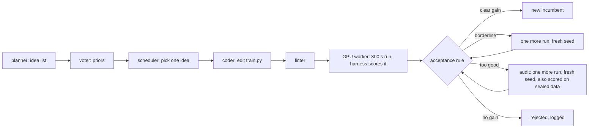

# Part 2: model routing inside an automated research loop

Paths in this file are relative to the repository root. Part 1 of the project is in `avrl/README.md`.

## The question and the short answer

**Question: in an automated research loop, which roles need the expensive model, and which can be given to cheap models without losing research output?**

**The setup.** The loop studied here lets LLM agents propose and test edits to the training script of Karpathy's nanochat autoresearch benchmark. Every test is a 300 second GPU training run scored by **val_bpb** (validation bits per byte, lower is better). Each agent fills a **role**: a planner proposes ideas, a coder writes the edit, a critic reviews results, and so on. A **routing table** assigns one model to each role. The experiments move roles from Claude Sonnet to cheaper models (Claude Haiku and two small open models, Qwen3.5-4B and Gemma 4 12B) and measure what happens to research output and to cost.

**What is measured.**

- **Research output** is reported as **held-out gain**. After a loop ends, its final script and the unmodified baseline are rerun on fresh seeds and scored on a sealed validation shard (data that no loop selects on). Held-out gain is the baseline's score minus the final script's, in bpb, so higher is better. For scale, the run-to-run standard deviation (sd) of the baseline is 0.004 to 0.005 bpb.
- **Cost** is reported two ways: **model dollars** (the price of the LLM calls alone) and total cost with GPU time added.

**Three terms needed to read the verdicts.**

- **Preregistration:** hypotheses, outcomes, tests and verdict rules are written down before the run, so the verdict cannot be chosen after the data are seen.
- **Harm control:** a loop configuration that is made worse on purpose. If the outcome measure cannot tell it from the normal loop, a finding of "no difference" between other configurations means little.
- **KILL:** the preregistered verdict when a check that the claim depends on fails. The measured numbers are still reported, but as description and not as a confirmed effect.

**The three main experiments.**

| Id | What it compares | Size | Verdict |
|---|---|---|---|
| R1 | Four loop configurations (arms A to D), each adding one layer: base loop, verification, planning, routing | 22 loops | Output: INCONCLUSIVE. Cost: the routed arm is noninferior to the unrouted planning arm and cheaper in model dollars |
| P1 | No new loops: the R1 data recomputed with GPU time priced in | the same 22 loops | Three preregistered decision lines, all PASS |
| P2 | Sonnet or cheap planner crossed with Sonnet or cheap coder, plus a harm control | 60 loops | KILL |

**The short answer.**

1. **The planner is the role that needs the strong model.** In P2, a Qwen3.5-4B planner lost about two thirds of the held-out gain (0.036 of 0.055 bpb).
2. **The coder did not show that need.** A calibrated cheap coder table (for each kind of edit, the cheapest model that passed a tryout before the run) cut model dollars about 8 times with no detectable coder main effect.
3. **Both statements are secondary outcomes under a KILL verdict.** The preregistered verdict of P2, the deciding experiment, is KILL, because its harm control was not detected on the preregistered endpoint (p = 0.22).
4. **The cost saving is large only in model dollars** (about 6 times in R1). Once GPU time is priced in, routing saves about 17 to 26 percent of the cost of a loop.

## How one loop iteration works

Terms used below:

- **Loop run:** one automated research run. It starts from the unmodified baseline `loop/substrate/base/train_ampere.py` and ends after 20 slots.
- **Slot:** the unit of budget. One slot is one GPU run (a candidate, a replicate, an audit or a crash fix), or one charged event without a run (for example an edit that fails the linter and cannot be repaired). Every loop gets the same number of slots, so loops are compared at an equal budget of GPU runs. Measured GPU hours still differ somewhat, because some slots are charged without a run. Failures of the queue or of a model server are retried and never charged.
- **Incumbent:** the best accepted version of `train.py` so far. Every candidate is an edit of it.
- **Anchor:** the mean val_bpb of the unmodified baseline, measured through the same workers. It is the first bar a candidate has to beat.
- **sigma and z:** sigma is the run-to-run noise of val_bpb for an unchanged script, fixed before launch from baseline runs (`sigma_used` in the anchor files). z is the candidate's improvement over the incumbent, counted in standard errors (formula in the safeguards section). A positive z means the candidate is better.
- **Sealed shard:** a validation data shard that no loop selects on. It is scored in audits and in the confirmation runs after the loops end.
- **Role:** one job filled by a model call: planner (proposes ideas), voter (rates ideas), coder (writes the edit), repairer (fixes a rejected edit), analyst (writes a memo of what has been learned), critic (reviews results and may veto).
- **Arm:** one loop configuration. R1 has four, each adding a layer to the one before: A (base loop), B (adds verification), C (adds planning), D (adds routing). The diagram and the table below describe the full loop of arms C and D; steps that only some arms run are marked. The next section gives the details.



Each step and the code that does it (modules are in `loop/core` unless a path is given):

| Step | What happens | Module and function |
|---|---|---|
| 1. Start | Read the config, connect the model layer and the GPU queue, run slots until the budget is used. | `run_loop.py`: `load_config`, `build_services`, `main`; `arms.py`: `LoopEngine.run`, `run_one_slot` |
| 2. Plan (arms C, D) | The planner writes a list of 30 ideas once per loop; near-duplicates are dropped; the voter gives each idea 3 yes or no votes, which set its starting score. More ideas are requested in two cases: when fewer than 5 are untried (a refresh), or after 5 rejections in a row (a widening call, which asks for different directions). | `arms.py`: `_pick_item`, `_plan`; `prompts.py`: `planner`, `voter`; `scheduler.py`: `dedup_new`, `seed_prior`, `should_widen` |
| 3. Pick (arms C, D) | Thompson sampling, a rule that balances promising ideas against untried ones. Each idea has a Beta distribution over its chance of success. Draw one score per idea from its distribution, divide it by one plus the number of times the idea was tried, and take the highest. | `scheduler.py`: `thompson_pick` |
| 4. Route | Look up which model fills the role. For the coder the lookup also uses the edit class: constant (only values of existing hyperparameters change), schedule (only the schedule functions or schedule constants change) or structural (any other function or class changes). | `arms.py`: `_route`, `_call`; `services.py`: `ModelService.call` |
| 5. Call the model | Claude models are called through the `claude` command-line binary, open models through vLLM servers (vLLM is an open-source inference server); replies must match a JSON schema; rate limits back off. | `loop/models/call.py`: `call`; `loop/models/consistency.py`: `sample_k` |
| 6. Apply the edit | The coder replies with SEARCH/REPLACE blocks; each block must match the incumbent exactly once. Arms A and B have no idea list: there a single base-step call sees the incumbent and writes the edit. | `arms.py`: `_attempt`, `_get_edit`; `prompts.py`: `coder`, `base_step`; `patch.py`: `apply_with_retries` |
| 7. Lint (arms B to D) | A syntax-tree check rejects edits that touch the seed, the evaluation, protected names or forbidden imports. One repair call is allowed. | `linter.py`: `lint`; `arms.py`: `_repair`; `prompts.py`: `repairer_lint` |
| 8. Queue the run | The candidate is written to the slot folder and submitted over ssh to a file queue on the GPU node. | `arms.py`: `_stage`, `_run_gpu`, `_drive_job`; `loop/substrate/queue_client.py`: `QueueClient.submit`, `wait` |
| 9. Train and score | A worker claims the job, sets the seed, appends the scoring code to the candidate and runs it for 300 s. The appended code recomputes val_bpb itself. | `loop/substrate/worker.py`: `Worker.claim`, `prepare_run`, `execute`, `patch_seed`; `loop/substrate/harness_tail.py`: `build_tail` |
| 10. Read the result | Integrity flags are checked (for example a printed score that differs from the recomputed one, or a changed hash); any flag rejects the candidate. A cleaned summary of the run is built for the next prompt. | `arms.py`: `_on_result`; `acceptance.py`: `integrity_flags`; `sanitize_log.py`: `sanitize_tail` |
| 11. Decide | Accept, reject, replicate on a fresh seed, or send to a sealed audit run (rule in the safeguards section). | `acceptance.py`: `decide_verified`, `decide_base`, `tripwire` |
| 12. Review (arms C, D) | The critic reviews three kinds of record: audits, borderline accepts (candidates accepted after a replicate with z below 2.0) and every 8th record. It can turn an accept into a reject. | `arms.py`: `_critic`; `prompts.py`: `critic` |
| 13. Record | One ledger record per event (the ledger is the loop's event log), with every model call and its cost attached. In arms C and D the idea's score is updated and the analyst rewrites the memo every 5 experiments. State is saved so a killed loop can resume. | `arms.py`: `_log`, `_charge`, `_finish`, `_memo`, `_save`; `ledger.py`: `new_record`, `Ledger.append`; `scheduler.py`: `update` |

Around the loops, `controller.py` (class `Controller`) runs a whole experiment:

- It plans the experiment, launches the loop processes and restarts crashed ones.
- It interleaves sentinel runs (baseline runs that track drift).
- It applies a symmetric stop: when the time window or the ceiling on Claude tokens is reached, every running loop is told to stop at the slot it has reached, and loops not yet started are skipped.

After the loops end, `confirmation.py` (`build_waves`, `run_confirmation`, `summarize`) reruns every final incumbent on fresh seeds. Held-out gain comes from these runs.

## Arms and routing tables

An **arm** is one loop configuration. A **routing table** is a JSON file that maps each role to a model name. Model names: `sonnet`, `haiku`, `opus` (Claude), `qwen35-4b` (Qwen3.5-4B), `gemma4-12b` (Gemma 4 12B). The open models run on local vLLM servers (`loop/runs/servers/SERVERS.md`).

**R1 arms** (defined in `loop/core/arms.py`). Each arm adds one layer to the previous one:

| Arm | What it adds | Models | Loops in R1 |
|---|---|---|---|
| A | Base loop: one model call writes each edit; keep it if its raw val_bpb is strictly lower. | Sonnet | 8 |
| B | Verification: linter, noise-aware acceptance with a replicate, and the option for the model to decline to spend a slot. | Sonnet | 3 |
| C | Planning: idea list with Thompson sampling, voter, analyst memo, critic with veto. | Sonnet for planner, coder, repairer, analyst; Haiku voter; Opus critic | 3 |
| D | Routing: the same loop as C, with models taken from the routing table below. | routing table | 8 |

**Calibration** is the tryout that produced the routing table. Before R1, each candidate model was sent a fixed set of tasks for each role and the replies were scored by code. A calibrated role goes to the cheapest model that passed the bar, and to Sonnet when nothing cheaper passed (`loop/core/CALIBRATION.md`).

**R1 routing table for arm D** (`loop/runs/R1/routing_table_frozen.json`, chosen by the calibration tryout before the run):

| Role | Model |
|---|---|
| planner, first idea list and widening | sonnet |
| planner, refresh of the idea list | qwen35-4b (never called in R1: no refresh fired, so every R1 planner call went to Sonnet) |
| coder, constant edits | qwen35-4b |
| coder, schedule edits | gemma4-12b |
| coder, structural edits | haiku |
| repairer | haiku |
| voter | gemma4-12b |
| analyst | sonnet |
| critic | opus |

**P2 cells** (built by `routing_table` in `loop/core/plan_p2.py`). P2 is a 2 x 2 factorial, planner by coder: every combination of two planners and two coders is run. A fifth cell, H, is the harm control. In a cell name the first letter is the planner (S for Sonnet, Q for Qwen3.5-4B) and the second is the coder (S for Sonnet, T for the cheap table). All cells run the arm D engine with voter gemma4-12b, analyst sonnet and critic opus.

| Cell | Planner (all three planner calls) | Coder | Repairer | Loops |
|---|---|---|---|---|
| SS | sonnet | sonnet | sonnet | 12 |
| ST | sonnet | cheap table: constant qwen35-4b, schedule gemma4-12b, structural haiku | haiku | 12 |
| QS | qwen35-4b | sonnet | sonnet | 12 |
| QT | qwen35-4b | cheap table (as ST) | haiku | 12 |
| H | sonnet | sonnet, with half of the new edits withheld | sonnet | 12 |

## Safeguards and why each exists

A loop that optimizes a number will find ways to move the number that are not real progress, and a 300 s training run is noisy. Each safeguard below closes one such path.

| Safeguard | What it does | Why it exists | Where |
|---|---|---|---|
| Pinned base | On every run the worker checks the data preparation code against a stored sha256 hash before the run starts, and the appended harness code checks the evaluation code and the data files against stored hashes before it scores; only `train.py` can change. | A candidate must not be able to change the evaluator or the data. | `loop/substrate/pinned_hashes.json`, `loop/substrate/base`, `worker.py`: `check_prepare`, `loop/substrate/harness_tail.py` |
| Harness-recomputed val_bpb | Code appended by the worker recomputes val_bpb from the model's raw outputs, checks a known-answer case, probes for label leakage and writes a receipt. The number the script prints is never used as the score: it is only compared with the recomputed value, and a difference above 0.0001 bpb flags the run, which is then rejected. | A candidate can print any number. In the stress test a candidate printed 0.5; the harness scored it 3.2158 and it was rejected (`loop/runs/T1/STRESS.md`). | `loop/substrate/harness_tail.py` |
| Linter | Rejects forbidden imports and calls, changes to seed lines, protected names and the model's forward signature. | A fast first gate before GPU time is spent. It is not the security boundary; the harness is. | `loop/core/linter.py` |
| Log sanitizing | The run summary shown to the models is rebuilt from the worker's result fields; raw log lines appear only for crashes, cleaned and cut to 300 characters. | The log is written by candidate code, so it could carry fake scores or instructions into the next prompt. | `loop/core/sanitize_log.py` |
| Noise-aware acceptance | z = (incumbent mean minus candidate) / (sigma x sqrt(1/n_c + 1/n_i)), where n_c and n_i are the numbers of runs behind the candidate and the incumbent. Reject below 0.75, accept at 2.0 or above, otherwise run once more on a fresh seed and accept if z over both runs is at least 1.5. | Run-to-run sd of the baseline is 0.004 to 0.005 bpb (`loop/runs/R1/anchor.json`, `loop/runs/P2F/anchor.json`), larger than most single-edit gains reported for this benchmark (0.0003 to 0.003, `loop/HISTORY.md`), so keep-if-lower accepts noise. | `loop/core/acceptance.py` |
| Tripwire audit | A single-step gain above 5 x sigma x sqrt(2), or a total gain above 0.03 bpb over the anchor, forces one more fresh-seed run, which is also scored on a sealed validation shard that no loop selects on. The candidate is accepted only if z over all of its runs is at least 1.5 (and, in arms C and D, the critic does not veto). | Very large gains are where metric gaming and lucky seeds are most likely. | `acceptance.py`: `tripwire` |
| Fresh-seed confirmation | After all loops end, each final incumbent is rerun on new seeds, mixed with baseline runs in the same wave, and scored on the sealed shard. **Held-out gain** is the baseline's sealed score minus the incumbent's. | Scores used for selection inside a loop look better than they are (the best of several noisy runs is biased toward a low val_bpb). Reported gains come only from runs that played no part in selection. | `loop/core/confirmation.py` |
| Harm control | In cell H a hash of (loop seed, slot, attempt) replaces half of the coder's new edits with a no-op. Everything else runs as usual. | A known-worse loop tests whether the outcome measure can detect harm at all. If it cannot, a "no difference" between cells means little. | `arms.py`: `_harm` |
| Preregistration | Hypotheses, outcomes, tests and verdict rules are written before the run. For P1 and P2 the sha256 hash of the file as frozen is stored. Later changes go to a Deviations section. Both files were edited after they were frozen (at least their Deviations sections were added), so the current files no longer hash to the stored values. | Fixes the analysis before the data exist, so the verdict cannot be chosen after the fact. | `loop/design/PREREG.md`, `loop/design/P1_PREREG.sha256`, `loop/design/P2_PREREG.sha256` |
| Burn-in and held-out halves | P1 splits the R1 loops in two. Rules are chosen on the burn-in half and tested once on the other half, which the script refuses to open without `P1_ALLOW_TEST=1`. | A rule tuned and tested on the same loops passes by construction. | `loop/p1/reaccount.py` |

## Experiment index

R1, P1 and P2 carry the results; the other entries prepare or check them.

| Id | Question | Design | Run folder | Analysis entry point | Verdict |
|---|---|---|---|---|---|
| noise | How noisy is the unmodified baseline? | `loop/design/DESIGN.md` | `loop/runs/noise` | `loop/runs/noise/summary.json` | Measurement: sd 0.0063 over 16 runs. This was a standalone batch job; the acceptance rule uses the noise measured through the GPU workers instead (the anchor files) |
| calibration | Which models are good enough for which role and edit class? | `loop/core/CALIBRATION.md` | `loop/runs/calibration` | `loop/core/calibration.py`, `loop/runs/calibration/routing_table.md` | Routing table frozen |
| T1 | Does the system survive kills, outages and a cheating candidate? | `loop/design/RUNBOOK.md` | `loop/runs/T1` | `loop/runs/T1/STRESS.md` | PASS; one engine bug found and fixed |
| T2 | Do accept, reject and audit all work live? | `loop/design/RUNBOOK.md` | `loop/runs/T2` | `loop/runs/T1/STRESS.md` (T2 section), `loop/HISTORY.md`, section 6 | PASS; the replicate path was not observed live (covered by unit tests) |
| R1 | What does each layer (verification, planning, routing) buy? | `loop/design/DESIGN.md`, `loop/design/PREREG.md` | `loop/runs/R1` | `loop/core/analysis.py`, `loop/runs/R1/analysis/report.md` | Output: INCONCLUSIVE. Cost: D noninferior to C and cheaper in model dollars |
| P1 | With GPU time priced in, what does a loop cost, when can it stop, and does noise explain R1's failed audits? | `loop/design/P1_PREREG.md` | `loop/runs/R1/p1` | `loop/p1/reaccount.py`, `loop/runs/R1/p1/test/report.md` | Three preregistered decision lines (plateau, halting rule, noise check), all PASS |
| calibration_requal | Does Haiku still qualify as structural coder and repairer on new test items? | `loop/runs/calibration_requal/PREREG.md` | `loop/runs/calibration_requal` | `loop/runs/calibration_requal/RESULT.md` | Haiku stays |
| P2 | Which role needs the expensive model, planner or coder? | `loop/design/P2_PREREG.md`, `loop/design/P2_RUNBOOK.md` | `loop/runs/P2` (first attempt), `loop/runs/P2R` (28 reruns), `loop/runs/P2F` (final set) | `loop/core/analysis_p2.py`, `loop/runs/P2F/RESULT.md` | KILL |

The Haiku effort-level study (P3) is not part of this folder; its code is under `avrl/exp`.

## Main results

How to read the numbers in this section:

- Held-out gain is in bpb and higher is better. Run-to-run sd of the baseline is 0.004 to 0.005 bpb.
- A difference written "X minus Y" is negative when X gained less than Y.
- Intervals are 90 percent intervals. An interval that includes zero means the difference was not detected.

### R1: four arms, 22 loops, 440 slots

**What was compared.** Arms A to D (base loop, plus verification, plus planning, plus routing), with 8, 3, 3 and 8 loops. Each loop ran 20 slots; afterwards every final incumbent was rerun on four fresh seeds. The table shows arm means. Source: `loop/runs/R1/analysis/report.md`.

| Arm | Held-out gain (bpb) | Model dollars per loop |
|---|---|---|
| A | 0.0633 | 0.78 |
| B | 0.0629 | 1.06 |
| C | 0.0607 | 1.44 |
| D | 0.0595 | 0.21 |

Arm D's 0.21 is Claude spend only; with its open models priced at hosted prices it is 0.24.

- **Research output: INCONCLUSIVE.** D minus A is -0.0038 bpb, 90 percent interval -0.0084 to +0.0009, p = 0.18. No step between neighboring arms (A to B, B to C, C to D) has an interval that excludes zero. The preregistration predicted this outcome.
- **Cost: routing is cheaper in model dollars.** D is noninferior to C at the preregistered margin of 0.01 bpb: the interval for D minus C (-0.0074 to +0.0054, point estimate -0.0012) rules out a loss as large as the margin. D costs about 5.9 times less per loop (0.243 against 1.442 dollars, open models at hosted prices, `loop/runs/R1/analysis/cost_report.md`).
- **Two predictions failed.** Arm A was predicted to show a larger gap between its claimed and confirmed scores (what a loop reports from its own selection runs against what fresh seeds confirm) and more than 3 bad accepts (accepted changes that moved the incumbent mean by less than sigma); neither happened. The tripwire audit ran in every arm, including arm A, where it rejected 5.0 of the 7.1 would-be keeps per loop (candidates that keep-if-lower alone would have kept).
- **Caveats.** Only 3 loops each in B and C. 18 of the 22 loops, spread over all four arms, ended with the same change in place (total batch size cut to 2^17 or below, `loop/design/P2_PREREG.md`), which leaves little room for arms to differ. The fresh-seed confirmation runs started about 100 minutes late.

### P1: the same R1 data with GPU time priced in

**What was done.** P1 runs no new loops. It recomputes R1 from the ledgers with GPU time priced in, and tests three preregistered decision lines: whether arms A and D stop improving at different slots, whether a halting rule can stop loops early at little loss, and whether noise alone explains the audits that arm A failed. Rules were chosen on a burn-in half (12 loops) and tested once on the other half (10 loops). Source: `loop/runs/R1/p1/test/report.md`; all-loop cost tables in `loop/runs/R1/p1/all/report.md`.

- **GPU time dominates.** At 2 dollars per A100-hour a loop costs A 5.42, B 5.64, C 6.05, D 4.49 dollars, so routing saves about 17 percent against A and 26 percent against C, not 6 times. GPU time is 76 to 95 percent of the total.
- **Plateau, PASS: arms A and D differ in when they stop improving** (Claim 1 in the preregistration). The plateau is the slot of the last incumbent change. A minus D is -12.5 slots, 90 percent interval -18 to -7: arm A plateaus earlier. The PASS condition was an interval that excludes zero. Up to the plateau, D costs more than A at every GPU price from 0 to 4 dollars per hour. A and D also differ in acceptance rule and scheduler, so the PASS says the arms differ, not that the model tier causes it (`loop/design/P1_PREREG.md`).
- **Halting rule, PASS.** The rule after_first_k5 stops a loop after 5 slots in a row without an incumbent change, counted from the first change. On the test loops it left 80 percent within 0.004 bpb of their final result while spending 51 percent of the dollars. The bar was at least 80 percent of loops at no more than 60 percent of the dollars.
- **Noise check, PASS** (N2 Test 1 in the preregistration). The check asks whether noise alone can explain the audits that arm A failed. A model in which every late candidate is pure noise predicts 15 to 25 rejected audits in the test-half arm A loops; 23 were observed. The preregistered PASS condition was a count inside the interval, so those failed audits are consistent with noise alone.
- **Caveats.** The halting rule was selected on the burn-in half. The test half is not fully blind, because exploratory numbers on all 22 loops existed before the split (stated in `loop/design/P1_PREREG.md`).

### Requalification: Haiku stays in the model pool

Haiku's two roles in the cheap table (structural coder and lint repairer) were tested again on new items. Haiku passed 30 of 30 as structural coder (95 percent lower bound 0.886, bar 0.75) and 20 of 20 as lint repairer (0.839, bar 0.6). Source: `loop/runs/calibration_requal/RESULT.md`.

### P2: planner by coder factorial with a harm control

**What was compared.** Five cells (SS, ST, QS, QT and the harm control H, defined under "Arms and routing tables"), 12 loops of 20 slots each, 60 loops in total. The loops ran in 12 randomized blocks; a block holds one loop of each cell in random order. Sources: `loop/runs/P2F/RESULT.md` and `loop/runs/P2F/analysis/report.md`.

**Primary outcome.** A loop **stalls** if its final incumbent still has a total batch size above 2^17. Cutting the batch size to 2^17 or below was the one change that separated good from poor loops in R1.

**Harm control test.** Cell H is compared with SS on how many slots a loop needs to reach a batch size of 2^17, with a one-sided log-rank test (a test of whether one group reaches an event later than the other).

**Preregistered verdict: KILL.** Cell H was not detectably slower than SS to reach a batch size of 2^17 (one-sided log-rank p = 0.22). KILL takes precedence over every other verdict in the preregistration, so everything below is description, not a confirmed effect.

Per-cell results (means over 12 loops, except Stall, which is a count):

| Cell | Planner | Coder | Stall | Held-out gain (bpb) | Accepted changes per loop | Model $ per loop | GPU hours per loop |
|---|---|---|---|---|---|---|---|
| SS | Sonnet | Sonnet | 7 of 12 | 0.0545 | 2.17 | 1.43 | 2.27 |
| ST | Sonnet | cheap table | 6 of 12 | 0.0560 | 2.08 | 0.25 | 2.08 |
| QS | Qwen3.5-4B | Sonnet | 9 of 12 | 0.0257 | 1.25 | 1.66 | 2.22 |
| QT | Qwen3.5-4B | cheap table | 11 of 12 | 0.0124 | 0.67 | 0.15 | 1.56 |
| H | Sonnet, half the edits withheld | Sonnet | 9 of 12 | 0.0328 | 1.17 | 1.45 | 2.29 |

Main effects. Each row compares the 24 loops that used the cheap option in one role with the 24 loops that used Sonnet in that role (cell H is left out). Held-out gain and stall rate are differences, cheap minus Sonnet. Model dollars is a ratio, cheap over Sonnet, computed on the log scale (a ratio of geometric means).

| Main effect (24 against 24 loops) | Held-out gain | Stall rate | Model dollars |
|---|---|---|---|
| Cheap planner (Q minus S) | -0.036 bpb, 90 percent interval -0.044 to -0.028, p below 0.001 | +0.29, p = 0.060 | ratio 0.83, p = 0.55 |
| Cheap coder table (T minus S) | -0.006 bpb, -0.017 to +0.006, p = 0.40, not significant | +0.04, p = 1.0 | ratio 0.13, p below 0.001 |

- **Planner.** The cheap planner lowered held-out gain by 0.036 bpb. Held-out gain was a preregistered secondary outcome. The effect shows in 11 of 12 blocks and is the same in kept loops (-0.0365) and reruns (-0.0355), the two parts of the final set described under Deviation below. On the primary outcome, the cheap planner raised the stall rate by 0.29, which passes the preregistered 0.25 margin for "the cheap tier hurts" by a single loop.
- **Coder.** No coder main effect was detected. This is not the same as "the cheap coder is harmless": with the Qwen planner the cheap table may hurt (QT minus QS -0.013, p = 0.12).
- **Cost.** The cheap coder table cut model dollars about 8 times. With GPU time at 2 dollars per A100-hour the total cost of a loop falls about 38 percent. A second cost measure is dollars per backed accepted change (an accepted change that rests on at least two runs with different seeds). On it, QT was 2.5 times cheaper than SS. A PASS verdict needed 5 times, and the 2.5 figure rests on 4 such changes in QT.
- **Mechanism (post hoc, found after the data were seen).** Final total batch size explains 78 percent of the variance in held-out gain. Sonnet planners put the batch-size cut into the first idea list in 36 of 36 loops, Qwen in 10 of 24. The calibration tryout had passed every planner 12 of 12, but it checked only the format of the reply.
- **Why the harm control missed.** SS reached 2^17 in only 5 of 12 loops, so the endpoint had 8 events in total across the two cells. On outcomes not preregistered for this comparison, H lost one accepted change per loop (p = 0.003) and 0.022 bpb (p = 0.005).
- **Deviation.** On Nov 7, from 14:19 to about 16:10 UTC, every Claude call failed with HTTP 403, an account-level refusal by the model provider. 28 of the first 60 loops were damaged and were rerun from scratch with identical configs (`loop/runs/P2R`). The final set is 32 kept loops plus 28 reruns (`loop/runs/P2F`).
  - The rerun set was fixed by the outage alone (every loop with a refused call), not by any outcome. However, an interim analysis of all 60 first-attempt loops had already been viewed when the outage was found (`loop/design/P2_PREREG.md`, Deviations).
  - The reruns ran about a day later; the effects agree across the two parts.
  - `loop/runs/P2/analysis_preconfirm` predates the reruns and is void.
- **Limits.** One benchmark, in which a single setting decides most of the outcome. `loop/runs/P2F/RESULT.md` also corrects three text errors in the generated report.

## How to run

Run from the repository root with Python 3 and the packages in `requirements-analysis.txt`, plus `pytest` for the tests. The tests and every analysis command work from the stored run files, with no GPU and no model calls.

```bash
# Tests: one call per folder (each folder has its own conftest.py)
python -m pytest -q loop/core/tests
python -m pytest -q loop/models/tests
python -m pytest -q loop/substrate/tests
python -m pytest -q loop/p1/tests

# R1 analysis and cost report (overwrite the stored files in loop/runs/R1/analysis)
python -m loop.core.analysis --run loop/runs/R1 --out loop/runs/R1/analysis
python -m loop.core.cost_report --run loop/runs/R1 --calibration loop/runs/calibration

# P1 re-accounting: burn-in half, then the held-out half with the frozen rule (writes under loop/runs/R1/p1; --out changes that)
python loop/p1/reaccount.py --half burnin
P1_ALLOW_TEST=1 python loop/p1/reaccount.py --half test --rule after_first:5

# P2 analysis (--out keeps the stored report in loop/runs/P2F/analysis untouched)
python -m loop.core.analysis_p2 --run loop/runs/P2F --out /tmp/p2_analysis

# Calibration table rebuilt from the stored trials, no model calls (rewrites the stored table files)
python -m loop.core.calibration --models sonnet haiku qwen35-9b gemma4-12b r1-qwen3-8b qwen35-4b \
    --out loop/runs/calibration --rebuild
```

Running new loops needs three things that are not in the repository: GPU workers on the cluster (`loop/substrate/start_workers.sbatch`, notes in `loop/substrate/deploy_hint.md`), the `claude` command-line binary with an account, and the vLLM servers (`loop/runs/servers/SERVERS.md`). The host name and remote paths in `loop/substrate/queue_client.py` are specific to the cluster used here. `ROOT` below is a new run folder.

```bash
# Calibration with live model calls (drop --rebuild)
python -m loop.core.calibration --models sonnet haiku qwen35-4b gemma4-12b --out ROOT/calibration

# One loop from a config file (see loop/core/ENGINE.md for the keys); --resume continues a killed loop
python -m loop.core.run_loop --config ROOT/A_01/config.json

# An R1-style experiment: plan, baseline runs, anchor, loops, confirmation, status
python loop/core/controller.py plan --root ROOT --seed 1
python loop/core/controller.py launch-sentinels --root ROOT --n 16
python loop/core/controller.py anchor --root ROOT
python loop/core/controller.py run --plan ROOT/plan.json --max-inflight 6 --window-hours 24
python loop/core/controller.py confirm --plan ROOT/plan.json
python loop/core/controller.py status --plan ROOT/plan.json

# P2: the plan as run (12 blocks, harm control in all 12), then the anchor
python -m loop.core.plan_p2 --root ROOT --seed 2 --harm-blocks 12
python -m loop.core.anchor_p2 --root ROOT --min-n 14
```

The remaining P2 steps (sentinels, `controller.py run`, `controller.py confirm`) are the same commands as above and are listed in `loop/design/P2_RUNBOOK.md`.

## File guide

| Path | Contents |
|---|---|
| `loop/core/run_loop.py`, `arms.py` | Entry point for one loop, and the loop engine (all arms). Schemas in `loop/core/ENGINE.md`. |
| `loop/core/acceptance.py`, `linter.py`, `patch.py`, `sanitize_log.py` | Decision rule, edit linter, edit application, log cleaning. |
| `loop/core/scheduler.py`, `ledger.py`, `prompts.py`, `services.py` | Idea selection, event log, all prompt text, the interface to models and GPUs. |
| `loop/core/controller.py`, `confirmation.py`, `restart_wrapper.sh` | Experiment controller and confirmation block. Notes in `loop/core/CONTROLLER.md`. |
| `loop/core/calibration.py`, `calib_specs.json` | Per-role tryout that produces a routing table. Notes in `loop/core/CALIBRATION.md`. |
| `loop/core/analysis.py`, `cost_report.py` | R1 analysis and cost tables. Notes in `loop/core/ANALYSIS.md`. |
| `loop/core/plan_p2.py`, `anchor_p2.py`, `analysis_p2.py` | P2 plan and routing tables, P2 anchor, P2 analysis. |
| `loop/core/tests` | Unit tests of the engine with fake models and a fake GPU queue. |
| `loop/models/call.py`, `consistency.py` | One function for every model call; repeated sampling for votes. |
| `loop/models/cost.py`, `budget.py`, `models.json`, `open_prices.json` | Cost accounting, token ceiling, model registry, prices for open models. |
| `loop/substrate/worker.py`, `queue_client.py`, `start_workers.sbatch` | GPU worker, the client that submits jobs, the Slurm script that starts workers. |
| `loop/substrate/harness_tail.py`, `pinned_hashes.json` | Scoring code appended to every candidate, and the pinned hashes. |
| `loop/substrate/base` | Pinned upstream files: baseline `train_ampere.py`, data preparation, the original program text. Not edited. |
| `loop/p1/reaccount.py` | P1 re-accounting of R1 (cost with GPU time, plateau, halting rules, noise replay). |
| `loop/design` | Design and runbook for R1, preregistrations for R1, P1 and P2 (sha256 files for P1 and P2), runbook for P2. |
| `loop/runs` | Stored results: one folder per experiment, one subfolder per loop (`config.json`, `state.json`, `ledger.jsonl`, `slots/`). |
| `loop/HISTORY.md` | Chronological record of the R1 build and run. |
