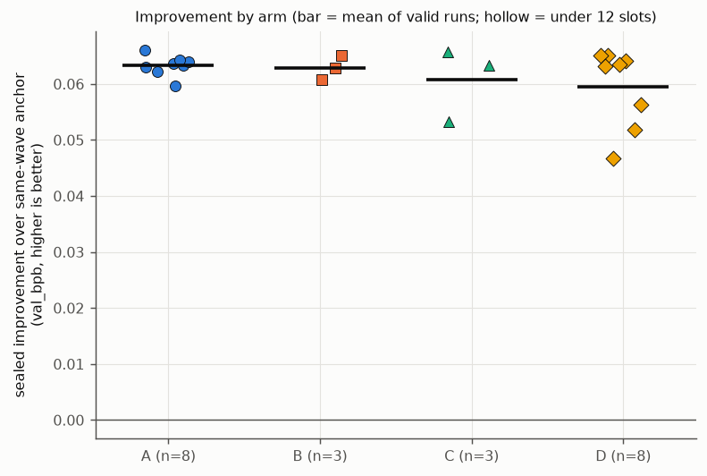
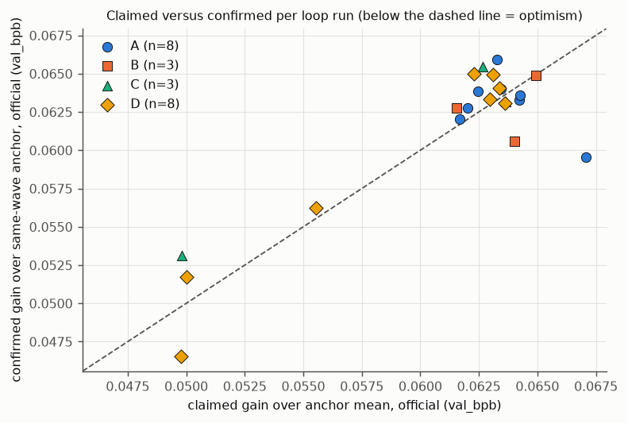
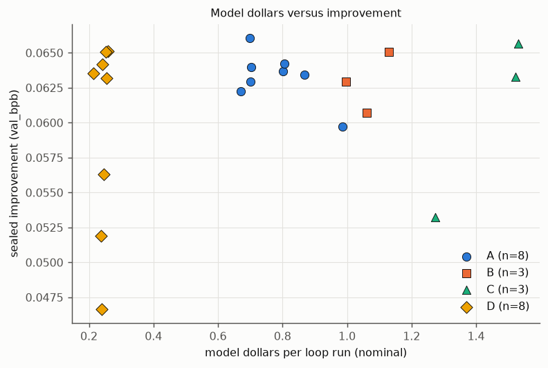
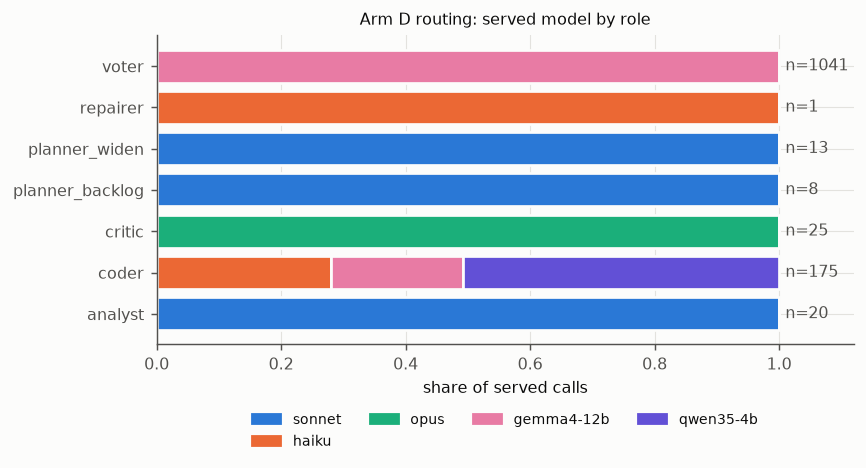
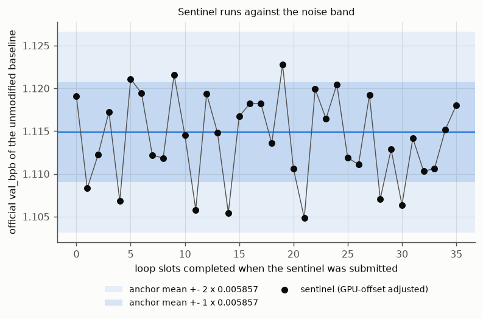
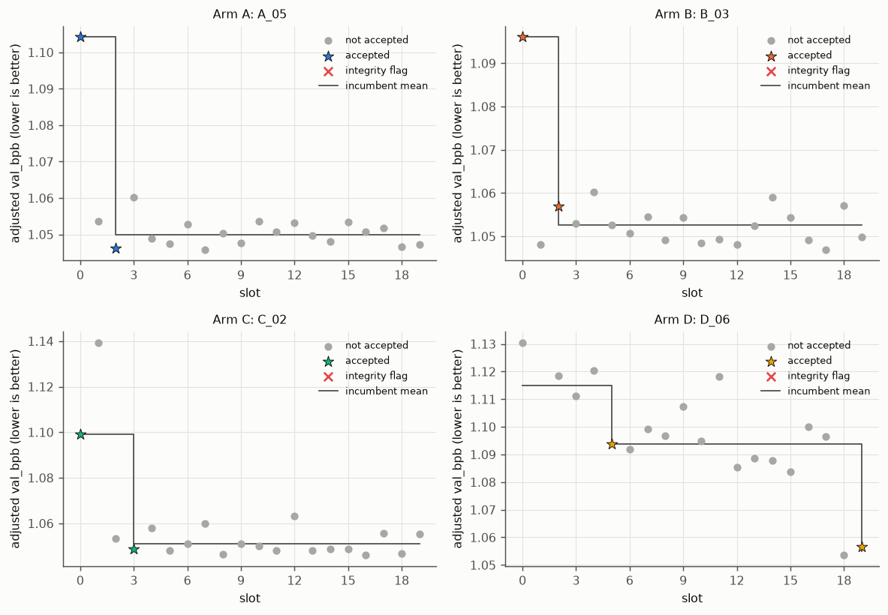

# Analysis report

Run: `loop/runs/R1`. Seed 1. 22 loop runs, 118 confirmation rows, 36 sentinel rows. sigma_used 0.004743. Anchor mean 1.114885.

## H1 (confirmatory)

H1 verdict: INCONCLUSIVE. Sealed improvement D minus A = -0.00380 val_bpb (90% permutation interval [-0.00837, +0.00085] by test inversion), two-sided exact permutation p = 0.1818 over 8 A and 8 D valid loop runs; the pre-registered rule needs p < 0.05 and an estimate beyond 0.003 in absolute value.

| arm | n | mean_improvement |
|---|---|---|
| A | 8 | 0.06328 |
| D | 8 | 0.05948 |

Sensitivity analyses (not the confirmatory test):

| analysis | n_A | n_D | estimate | p | lo | hi |
|---|---|---|---|---|---|---|
| valid runs (confirmatory) | 8 | 8 | -0.00380 | 0.18182 | -0.00837 | 0.00085 |
| intention to treat, all runs | 8 | 8 | -0.00380 | 0.18182 | -0.00837 | 0.00085 |
| ITT, D coefficient adjusted for slots completed (OLS point estimate) | n/a | n/a | -0.00380 | n/a | n/a | n/a |
| valid runs excluding degraded D | 8 | 8 | -0.00380 | 0.18182 | -0.00837 | 0.00085 |

## Rung contrasts (descriptive: estimate and 90% percentile bootstrap interval, no p-values)

| contrast | n_ref | n_treat | estimate | lo | hi |
|---|---|---|---|---|---|
| B minus A | 8 | 3 | -0.00039 | -0.00238 | 0.00159 |
| C minus B | 3 | 3 | -0.00217 | -0.00769 | 0.00272 |
| D minus C | 3 | 8 | -0.00124 | -0.00745 | 0.00537 |

## Loop runs

Process columns:

| arm | loop_id | slots_completed | valid | accepts | replicates | audits | integrity_flags | tripwires | lint_failures | bad_accepts | model_calls | model_usd_plan | model_usd_nominal | served_fraction | served_fraction_ledger | degraded |
|---|---|---|---|---|---|---|---|---|---|---|---|---|---|---|---|---|
| A | A_01 | 20 | yes | 3 | 0 | 3 | 0 | 3 | 0 | 0 | 17 | 0.986 | 0.986 | n/a | n/a | no |
| A | A_02 | 20 | yes | 2 | 0 | 8 | 0 | 8 | 0 | 0 | 12 | 0.671 | 0.671 | n/a | n/a | no |
| A | A_03 | 20 | yes | 2 | 0 | 8 | 0 | 8 | 0 | 0 | 12 | 0.700 | 0.700 | n/a | n/a | no |
| A | A_04 | 20 | yes | 2 | 0 | 7 | 0 | 8 | 0 | 0 | 13 | 0.699 | 0.699 | n/a | n/a | no |
| A | A_05 | 20 | yes | 2 | 0 | 5 | 0 | 6 | 0 | 0 | 15 | 0.869 | 0.869 | n/a | n/a | no |
| A | A_06 | 20 | yes | 2 | 0 | 7 | 0 | 7 | 0 | 0 | 13 | 0.702 | 0.702 | n/a | n/a | no |
| A | A_07 | 20 | yes | 2 | 0 | 6 | 0 | 6 | 0 | 0 | 14 | 0.801 | 0.801 | n/a | n/a | no |
| A | A_08 | 20 | yes | 2 | 0 | 5 | 0 | 5 | 0 | 0 | 15 | 0.806 | 0.806 | n/a | n/a | no |
| B | B_01 | 20 | yes | 2 | 1 | 1 | 0 | 1 | 0 | 0 | 18 | 1.062 | 1.062 | n/a | n/a | no |
| B | B_02 | 20 | yes | 2 | 0 | 1 | 0 | 1 | 0 | 0 | 19 | 1.129 | 1.129 | n/a | n/a | no |
| B | B_03 | 20 | yes | 2 | 2 | 1 | 0 | 1 | 0 | 0 | 17 | 0.998 | 0.998 | n/a | n/a | no |
| C | C_01 | 20 | yes | 1 | 2 | 1 | 0 | 1 | 0 | 0 | 207 | 1.531 | 1.531 | n/a | n/a | no |
| C | C_02 | 20 | yes | 2 | 2 | 1 | 0 | 1 | 0 | 0 | 178 | 1.522 | 1.522 | n/a | n/a | no |
| C | C_03 | 20 | yes | 2 | 2 | 2 | 0 | 2 | 0 | 0 | 143 | 1.273 | 1.273 | n/a | n/a | no |
| D | D_01 | 20 | yes | 2 | 1 | 2 | 0 | 2 | 0 | 0 | 176 | 0.203 | 0.238 | 1.000 | 0.981 | no |
| D | D_02 | 20 | yes | 1 | 3 | 2 | 0 | 2 | 0 | 0 | 160 | 0.230 | 0.258 | 1.000 | 0.979 | no |
| D | D_03 | 20 | yes | 3 | 2 | 2 | 0 | 2 | 0 | 0 | 143 | 0.219 | 0.247 | 1.000 | 0.969 | no |
| D | D_04 | 20 | yes | 3 | 0 | 2 | 0 | 2 | 0 | 0 | 150 | 0.211 | 0.242 | 1.000 | 0.970 | no |
| D | D_05 | 20 | yes | 2 | 0 | 1 | 0 | 1 | 0 | 0 | 174 | 0.201 | 0.239 | 1.000 | 0.961 | no |
| D | D_06 | 20 | yes | 2 | 3 | 1 | 0 | 1 | 0 | 0 | 156 | 0.185 | 0.214 | 1.000 | 0.965 | no |
| D | D_07 | 20 | yes | 2 | 2 | 1 | 0 | 1 | 0 | 0 | 169 | 0.223 | 0.253 | 1.000 | 0.980 | no |
| D | D_08 | 20 | yes | 3 | 0 | 3 | 0 | 3 | 0 | 0 | 155 | 0.227 | 0.256 | 1.000 | 0.963 | no |

served_fraction_ledger is open-served over designated-open model calls in the ledger, using the frozen routing table `loop/runs/calibration/routing_table.json`; served_fraction comes from the state counters, which skip health-check reroutes. The degraded flag (arm D, under 0.8) uses served_fraction_ledger.

Outcome columns:

| arm | loop_id | n_confirm | claimed_best_official | confirmed_official_mean | confirmed_sealed_mean | improvement | gap_sel | gap_shard |
|---|---|---|---|---|---|---|---|---|
| A | A_01 | 4 | 1.04781 | 1.05268 | 1.05192 | 0.05970 | 0.00751 | 0.00014 |
| A | A_02 | 4 | 1.05321 | 1.05304 | 1.05225 | 0.06226 | -0.00039 | 0.00020 |
| A | A_03 | 4 | 1.05287 | 1.05283 | 1.05206 | 0.06295 | -0.00076 | 0.00018 |
| A | A_04 | 4 | 1.05162 | 1.05273 | 1.05200 | 0.06606 | -0.00264 | 0.00016 |
| A | A_05 | 4 | 1.05066 | 1.05296 | 1.05222 | 0.06341 | 0.00096 | 0.00014 |
| A | A_06 | 4 | 1.05242 | 1.05298 | 1.05221 | 0.06400 | -0.00136 | 0.00016 |
| A | A_07 | 4 | 1.05061 | 1.05308 | 1.05235 | 0.06367 | 0.00070 | 0.00010 |
| A | A_08 | 4 | 1.05145 | 1.05294 | 1.05216 | 0.06421 | -0.00058 | 0.00019 |
| B | B_01 | 4 | 1.05085 | 1.05261 | 1.05190 | 0.06069 | 0.00346 | 0.00012 |
| B | B_02 | 4 | 1.04994 | 1.05308 | 1.05233 | 0.06506 | 0.00008 | 0.00020 |
| B | B_03 | 4 | 1.05333 | 1.05287 | 1.05212 | 0.06293 | -0.00118 | 0.00018 |
| C | C_01 | 4 | 1.05222 | 1.05332 | 1.05257 | 0.06567 | -0.00282 | 0.00019 |
| C | C_02 | 4 | 1.05122 | 1.05288 | 1.05222 | 0.06327 | 0.00050 | 0.00011 |
| C | C_03 | 4 | 1.06506 | 1.06651 | 1.06581 | 0.05323 | -0.00330 | 0.00011 |
| D | D_01 | 4 | 1.06488 | 1.06642 | 1.06571 | 0.05190 | -0.00174 | 0.00015 |
| D | D_02 | 4 | 1.05258 | 1.05302 | 1.05232 | 0.06511 | -0.00266 | 0.00014 |
| D | D_03 | 4 | 1.05935 | 1.05800 | 1.05736 | 0.05628 | -0.00071 | 0.00003 |
| D | D_04 | 4 | 1.05149 | 1.05332 | 1.05268 | 0.06415 | -0.00067 | 0.00009 |
| D | D_05 | 4 | 1.06510 | 1.06639 | 1.06569 | 0.04664 | 0.00324 | 0.00010 |
| D | D_06 | 4 | 1.05191 | 1.05289 | 1.05210 | 0.06354 | -0.00034 | 0.00023 |
| D | D_07 | 4 | 1.05179 | 1.05281 | 1.05205 | 0.06507 | -0.00183 | 0.00014 |
| D | D_08 | 4 | 1.05126 | 1.05346 | 1.05281 | 0.06316 | 0.00057 | 0.00011 |

## Arm summary (valid runs, mean)

| arm | runs | valid | improvement | gap_sel | gap_shard | accepts | bad_accepts | usd_plan | usd_nominal | audits | audit_rejects | audit_accepts | would_be_keeps | audit_reject_rate |
|---|---|---|---|---|---|---|---|---|---|---|---|---|---|---|
| A | 8 | 8 | 0.0633 | 0.0004 | 0.0002 | 2.1250 | 0.0000 | 0.7792 | 0.7792 | 6.1250 | 5.0000 | 1.1250 | 7.1250 | 0.7789 |
| B | 3 | 3 | 0.0629 | 0.0008 | 0.0002 | 2.0000 | 0.0000 | 1.0629 | 1.0629 | 1.0000 | 0.0000 | 1.0000 | 2.0000 | 0.0000 |
| C | 3 | 3 | 0.0607 | -0.0019 | 0.0001 | 1.6667 | 0.0000 | 1.4421 | 1.4421 | 1.3333 | 0.3333 | 1.0000 | 2.0000 | 0.1667 |
| D | 8 | 8 | 0.0595 | -0.0005 | 0.0001 | 2.2500 | 0.0000 | 0.2122 | 0.2433 | 1.7500 | 0.1250 | 1.6250 | 2.3750 | 0.0625 |

Audit columns: once the cumulative tripwire trips (gain over the anchor above 0.03) every would-be accept is audited, in every arm including the control. audit_rejects counts audits that rejected, audit_accepts audits that confirmed, would_be_keeps = accepts + audit_rejects (what a keep-if-lower rule would have kept had audits not run; for arm A this is the pure Karpathy keep count) and audit_reject_rate = audit_rejects / audits (per-run values, averaged over valid runs that had audits). Audits in arm A are replication the control would not otherwise have had, so A's accepts are already filtered; audit_rejects in A estimate how many noise keeps the plain rule would have accepted.

## H2: selection gap (descriptive; positive = the loop's claim is optimistic)

| arm | n | mean | lo | hi |
|---|---|---|---|---|
| A | 8 | 0.00043 | -0.00100 | 0.00229 |
| B | 3 | 0.00078 | -0.00076 | 0.00233 |
| C | 3 | -0.00187 | -0.00314 | -0.00061 |
| D | 8 | -0.00052 | -0.00145 | 0.00053 |

Predictions: A_larger_than_each_verified = no, A_in_0p010_to_0p013 = no, verified_under_0p006 = yes.

## H3: bad-accept proxy (accepted changes with single-step adjusted delta under sigma_used)

| arm | n | mean | lo | hi |
|---|---|---|---|---|
| A | 8 | 0.000 | 0.000 | 0.000 |
| B | 3 | 0.000 | 0.000 | 0.000 |
| C | 3 | 0.000 | 0.000 | 0.000 |
| D | 8 | 0.000 | 0.000 | 0.000 |

Predictions: A_over_3 = no, verified_at_most_1 = yes.

## H4: routing (D without degraded runs versus C)

| n_D | n_D_degraded | served_fraction_mean | served_fraction_ledger_mean | n_D_clean | n_C | estimate_D_minus_C | lo | hi | noninferior |
|---|---|---|---|---|---|---|---|---|---|
| 8 | 0 | 1.0000 | 0.9713 | 8 | 3 | -0.0012 | -0.0074 | 0.0054 | yes |

| usd_per_accept_plan_D | usd_per_accept_plan_C | D_cheaper_plan | usd_per_accept_nominal_D | usd_per_accept_nominal_C | D_cheaper_nominal |
|---|---|---|---|---|---|
| 0.1068 | 0.9762 | yes | 0.1223 | 0.9762 | yes |

Noninferior means the lower end of the 90% bootstrap interval of D minus C improvement is above -0.01.

## H5: open-model coder qualification

Ledger proxy (arm D, coder calls served by open models; pass = lint ok and run status ok):

| edit_class | n | passes | rate | wilson_lower | bar | qualifies |
|---|---|---|---|---|---|---|
| constant | 40 | 39 | 0.975 | 0.871 | 0.600 | yes |
| mixed | 5 | 5 | 1.000 | 0.566 | 0.600 | no |
| schedule | 39 | 39 | 1.000 | 0.910 | 0.600 | yes |
| structural | 3 | 2 | 0.667 | 0.208 | 0.750 | no |
| unknown | 12 | 0 | 0.000 | 0.000 | 0.600 | no |

Prediction (constant and schedule qualify, structural does not): yes.

## Secondaries (permutation test of the difference of means, Benjamini-Hochberg q < 0.10 over these six)

| name | contrast | n_ref | n_treat | estimate | p | method | q | significant |
|---|---|---|---|---|---|---|---|---|
| gap_sel (A vs D) | D minus A | 8 | 8 | -0.0009 | 0.5197 | exact | 0.6236 | no |
| gap_shard (A vs D) | D minus A | 8 | 8 | -0.0000 | 0.1694 | exact | 0.2541 | no |
| accepts per run (A vs D) | D minus A | 8 | 8 | 0.1250 | 1.0000 | exact | 1.0000 | no |
| integrity + tripwire counts (A vs D) | D minus A | 8 | 8 | -4.6250 | 0.0003 | exact | 0.0009 | yes |
| model dollars per run, nominal (A vs D) | D minus A | 8 | 8 | -0.5359 | 0.0002 | exact | 0.0009 | yes |
| D cost per accepted change, nominal (C vs D) | D minus C | 3 | 8 | -0.8540 | 0.0061 | exact | 0.0121 | yes |

## Live sigma check

Sentinel sd (GPU-offset adjusted) 0.005149 against the noise-job residual sd 0.005857 (ratio 0.879, n = 36; raw sd 0.003601). Within 25 percent, no replay needed.

Per-GPU sentinel means (raw official val_bpb):

| gpu | n | mean | sd | offset_observed | offset_frozen |
|---|---|---|---|---|---|
| 0 | 5 | 1.11192 | 0.00292 | -0.00167 | 0.00262 |
| 1 | 6 | 1.11351 | 0.00389 | -0.00007 | -0.00419 |
| 2 | 17 | 1.11444 | 0.00362 | 0.00086 | -0.00221 |
| 3 | 8 | 1.11286 | 0.00385 | -0.00072 | 0.00378 |

## Figures

## Deviations (copied from PREREG.md)

Launched: controller started 2026-10-21 02:51:20 EDT (06:51:20 UTC) (plan loop/runs/R1/plan.json, 22 loop runs, 20 slots each, window 24 h). The last integration loops (T2) were still finishing their in-flight slots on the shared queue during the first minutes; this delays all arms equally.

Deviation 1 (Oct 21): all 22 loop runs finished at 16:46 EDT (20:46:53 UTC), 13.9 h after launch, with 440 slots and 36 sentinels; the confirmation block started at 18:28 EDT instead of immediately, because the launcher watching for the controller's exit matched its own process name and never fired. The GPUs were idle for about 100 minutes. Confirmation waves still run four-wide with a same-wave anchor, so arm contrasts are unaffected; the gap only shifts the block later in the window.

(no other deviations)

## Power and limits

With 8 A and 8 D valid runs and an observed within-arm sd of 0.0051, the minimum detectable D minus A difference at 80% power is about 0.0072 val_bpb (normal approximation; PREREG states roughly 0.5 power at a true 0.008), so a non-significant H1 would not be evidence of no effect; B and C rest on about 3 runs each and are descriptive only, model cost is not randomized, arm A is a stateless one-shot control and not Karpathy's persistent session, and the harness tail defends against accidents and opportunism, not a deliberate adversary.
